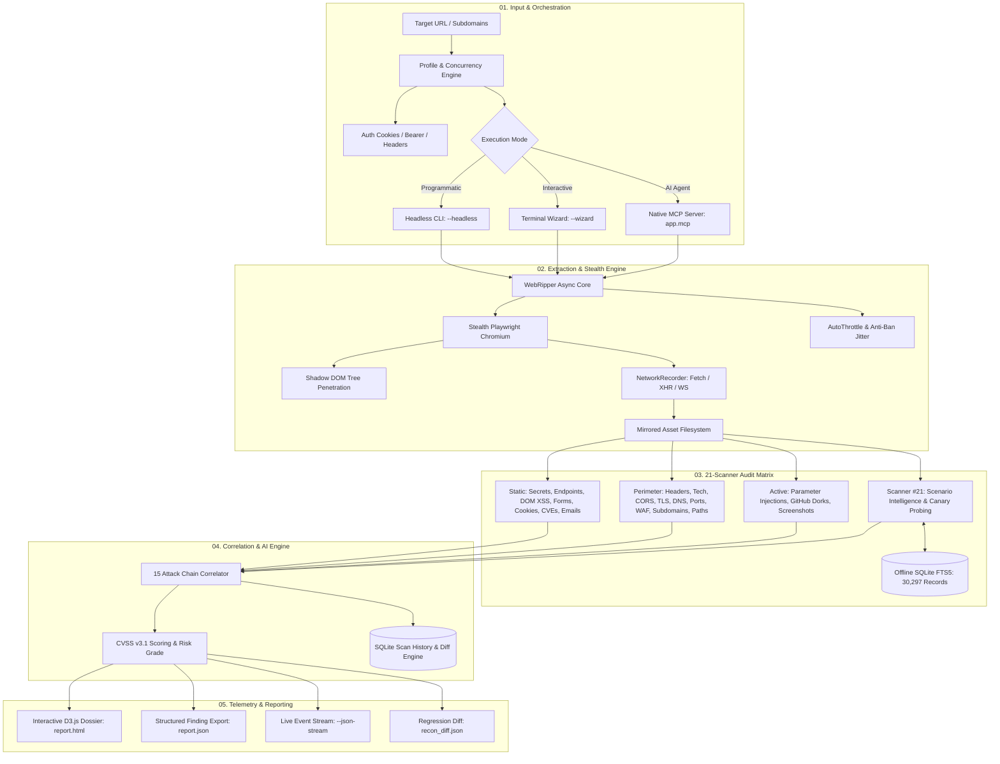

# WEBRIPPER RECON 5.0 — COMPREHENSIVE ARCHITECTURE & OPERATIONAL MANUAL

```
========================================================================================================
   _       ______________  ______  ____  ____  __________     ____  ________________  _   __   ______
  | |     / / ____/ __ )/ / __ \/ __ \/ __ \/ ____/ __ \   / __ \/ ____/ ____/ __ \/ | / /  / ____/
  | | /| / / __/ / __  / / /_/ / /_/ / /_/ / __/ / /_/ /  / /_/ / __/ / /   / / / /  |/ /  /___ \ 
  | |/ |/ / /___/ /_/ / / _, _/ ____/ ____/ /___/ _, _/  / _, _/ /___/ /___/ /_/ / /|  /  ____/ / 
  |__/|__/_____/_____/_/_/ |_/_/   /_/   /_____/_/ |_|  /_/ |_/_____/\____/\____/_/ |_/  /_____/  
========================================================================================================
 [>] AGENT-NATIVE AUTOMATED RECONNAISSANCE ENGINE // PURE-CLI CYBER DEFENSE PLATFORM // PYTHON 3.11+
========================================================================================================
 ┌────────────────────────────────────────────────────────────────────────────────────────────────────┐
 │  CORE: Pure Python 3.11+       AUDIT: 21 Specialized Scanners     INTELLIGENCE: 30,297 FTS5 Recs   │
 │  RUNTIME: Headless / Zero-GUI  CHAINS: 15 Attack Path Correlators PROTOCOL: MCP JSON-RPC 2.0 Stdio│
 └────────────────────────────────────────────────────────────────────────────────────────────────────┘
```

[](https://www.python.org/downloads/)
[](LICENSE)
[](tests/)
[](app/mcp/)
[](app/intelligence/)

---

## 1. Executive Summary & Purpose

**WebRipper Recon 5.0** is an authorized, non-destructive, agent-native web security reconnaissance and attack-surface auditing engine built in Python 3.11+. 

Designed for DevSecOps engineers, security researchers, and autonomous AI coding agents (**Claude Code**, **Cursor**, **Antigravity**, **Hermes**), WebRipper Recon consolidates asset discovery, stealth scraping, 21-scanner vulnerability auditing, offline bug bounty scenario intelligence, and multi-stage attack chain correlation into a high-performance headless architecture.

### Key Capabilities
* **Pure CLI & Agent-Native Architecture**: Completely headless with zero desktop GUI dependencies. Run interactively with the terminal wizard (`--wizard`) or non-interactively in CI/CD pipelines and AI agent tool loops.
* **Semantic Exit Codes**: Deterministic status codes (`0` Clean, `1` Error, `2` High/Critical Finding, `3` WAF Blocked, `4` Rate Limited) for automated build gating.
* **Offline Scenario Intelligence (Scanner #21)**: Embedded SQLite FTS5 database (`intel.db`) containing **30,297 indexed intelligence records** (Nuclei templates, HackerOne bug bounty reports, CISA KEV entries, PortSwigger research techniques, and cloud takeover fingerprints). Issues 15–20 focused canary verification probes matching detected tech stacks.
* **Native Model Context Protocol (MCP) Server**: Embedded stdio JSON-RPC 2.0 server (`python -m app.mcp`) providing first-class agent tools (`webripper_scan`, `lookup_vulnerability_intelligence`, `run_canary_probe`, `get_attack_chains`, `list_scans`).
* **Real-Time NDJSON Streaming & Diffing**: Stream live structured audit events via `--json-stream` and automatically calculate security regressions against baselines using `--diff`.
* **15 Correlated Attack Chains**: Correlates isolated findings into composite attack paths (e.g., Next.js Server Actions + Source Maps, Spring Boot Actuators + Cloud IMDS SSRF, Subdomain Takeover + OAuth Callback Whitelist).
* **Stealth Playwright Crawler**: Anti-fingerprinted browser crawling with Shadow DOM penetration, network traffic recording (Fetch/XHR/WebSocket), and adaptive auto-throttling.
* **Interactive D3.js Threat Dossier**: Self-contained single-file HTML reports featuring force-directed attack graphs, CVSS 3.1 risk scores, and machine-readable JSON exports.

```text
                     .---.
                    /     \               [+] MISSION RECONNAISSANCE COCKPIT [+]
                   | () () |
                    \  ^  /               TARGET  : https://staging.example.com
                     |||||                PROFILE : STANDARD (Balanced Audit, Depth 2)
                     |||||                ENGINE  : WebRipper Recon 5.0 (Pure-CLI)
                 .---'     '---.          STATUS  : 21 Scanners Dispatched | AutoThrottle ±15%
                /               \
               |  [!] CRIT : 01  |        [!] FINDINGS RADAR DISCOVERY
               |  [*] HIGH : 02  |        ----------------------------------------------------
               |  [-] MED  : 03  |        CRITICAL [████████████████████] 1 (AWS Secret in JS)
               |  [.] LOW  : 05  |        HIGH     [██████████░░░░░░░░░░] 2 (CORS Creds + Next.js)
                \               /         MEDIUM   [██████░░░░░░░░░░░░░░] 3 (No CSP, No CSRF, SameSite)
                 '-------------'          LOW/INFO [████░░░░░░░░░░░░░░░░] 5 (Server Header, TLS 1.2)
                        |
                        +---------------> OVERALL SECURITY POSTURE GRADE: [ C ] (CVSS: 5.8)
```

---

## 2. High-Level Architectural Flow



---

## 3. The 21-Scanner Security Matrix

WebRipper Recon 5.0 executes 21 specialized audit scanners against mirrored assets, server headers, and network endpoints:

| Scanner | ID / Module | Category | Capabilities & Detection Logic |
| :--- | :--- | :--- | :--- |
| **01** | `scenarios.py` | Intelligence | Targeted bug bounty canary probes via FTS5 database matching detected tech stacks. |
| **02** | `tech.py` | Perimeter | Fingerprints CMSs, web frameworks, CDNs, servers, and passive Favicon MD5 hashes. |
| **03** | `secrets.py` | AppSec | Shannon entropy analysis & 30+ regexes for AWS, Google, GitHub, JWT, Stripe, SSH keys. |
| **04** | `endpoints.py` | API Recon | Discovers REST, GraphQL, WebSocket, and Next.js routes in minified JS and source files. |
| **05** | `javascript.py` | Client-Side | Static taint analysis for DOM XSS sinks (`eval`, `innerHTML`, `document.write`). |
| **06** | `forms.py` | Auth / CSRF | Audits HTML `<form>` tags for plaintext transmission, missing CSRF tokens, weak inputs. |
| **07** | `cookies.py` | Session Sec | Verifies `Set-Cookie` attributes (`HttpOnly`, `Secure`, `SameSite`, prefix rules). |
| **08** | `cves.py` | Known CVEs | Cross-references identified software versions with public CVE and exploit databases. |
| **09** | `headers.py` | Perimeter | Evaluates `HSTS`, `CSP`, `X-Frame-Options`, `Permissions-Policy`, and CORS policies. |
| **10** | `cors.py` | Origin Audit | Probes origin reflection with credentials (`Origin: https://evil.com` and `null`). |
| **11** | `tls.py` | Cryptography | Checks certificate expiration, self-signed chains, and deprecated TLS 1.0/1.1 protocols. |
| **12** | `dns.py` | DNS / OSINT | Resolves A, AAAA, MX, TXT, SPF, CNAME records; detects dangling CNAME pointers. |
| **13** | `portscan.py` | TCP Perimeter | Non-blocking socket port scanner (ports 21–8443) with HTTP active banner grabbing. |
| **14** | `waf.py` | WAF Profiling | Fingerprints Cloudflare, AWS WAF, Akamai, Imperva, ModSecurity, and Fastly. |
| **15** | `subdomains.py`| Host Discovery| Resolves curated high-value subdomains (`api`, `dev`, `stage`, `admin`, `vpn`, `auth`). |
| **16** | `paths.py` | Sensitive Paths| Probes for exposed `.env`, `.git`, `backup.sql`, `phpinfo.php`, `/admin`, `.DS_Store`. |
| **17** | `vulns.py` | Active Injections| Non-destructive canary injection probes for Reflected XSS, SQLi errors, Open Redirects, SSRF. |
| **18** | `github_dork.py`| OSINT | Generates targeted GitHub search dork URLs to locate external repository leaks. |
| **19** | `emails.py` | OSINT | Extracts corporate email addresses, author metadata, and contact directories. |
| **20** | `screenshots.py`| Visual Recon | Captures high-resolution full-page PNG screenshots via Playwright. |
| **21** | `External Tools`| CLI Tools | Coordinates external binaries (Nmap, Nuclei, SQLmap, Gobuster, HTTPX, Subfinder). |

---

## 4. Offline Vulnerability Scenario Intelligence Engine

WebRipper Recon 5.0 embeds an offline SQLite FTS5 database ([`app/intelligence/intel.db`](file:///c:/Users/JAI/Desktop/webripper2.0/app/intelligence/intel.db)) containing **30,297 indexed intelligence records**:

```
┌────────────────────────────────────────────────────────────────────────┐
│                   WEBRIPPER RECON INTELLIGENCE CATALOG                 │
├────────────────────────────────────────────────────────────────────────┤
│ • 11,835 Nuclei Community Signatures & Matchers                       │
│ • 15,219 HackerOne Disclosed Bug Bounty Reports (with Payouts)         │
│ •  1,790 CISA Known Exploited Vulnerabilities (KEV) Catalog            │
│ •  1,363 Curated Scenario Canary Recipes                               │
│ •     76 Subdomain Takeover Cloud Fingerprints                         │
│ •     14 PortSwigger Advanced Web Research Methodologies               │
└────────────────────────────────────────────────────────────────────────┘
```

### Targeted Canary Probing (Zero WAF Noise)
Rather than firing thousands of brute-force requests, **Scanner #21** identifies the target's technology stack (e.g., Next.js, Spring Boot, Laravel, Django, WordPress) and dispatches only **15–20 high-confidence, non-destructive canary verification requests**.

Query the database directly from the CLI:
```bash
python -m app.main --intel-query "Spring Boot Actuator"
python -m app.main --intel-query "Next.js Server Actions"
```

---

## 5. Correlated Attack Chains (Chains 1–15)

The correlation engine ([`app/correlator.py`](file:///c:/Users/JAI/Desktop/webripper2.0/app/correlator.py)) synthesizes isolated low- and medium-severity findings into actionable multi-step attack scenarios:

* **Chain 01**: Source Code Leak (`.git`) → Credential Extraction → Direct Database Access.
* **Chain 02**: DOM XSS Sink + Missing CSP + Missing `HttpOnly` → Session Hijacking.
* **Chain 03**: Sensitive Form + Missing CSRF Token → Unauthorized Account Modification.
* **Chain 04**: Subdomain Takeover + Wildcard Parent Domain Cookie → Global Session Hijacking.
* **Chain 05**: CORS Wildcard Origin + Credentials + Sensitive API → Cross-Origin Data Exfiltration.
* **Chain 06**: Exposed Admin Interface + Disclosed Credentials + No Rate Limit → Administrative Takeover.
* **Chain 07**: Multiple Critical Perimeter Ports Exposed → Direct Infrastructure Attack.
* **Chain 08**: Deprecated TLS 1.0/1.1 + Plaintext Login Form → Network Credential Interception.
* **Chain 09**: Known Unpatched Critical CVE + Exposed Service → Public Exploit Application.
* **Chain 10**: Next.js Server Actions + Exposed Source Maps → Internal Backend Schema Exploitation.
* **Chain 11**: Spring Boot Actuator (`/env`, `/heapdump`) + SSRF → Cloud IMDS / IAM Role Takeover.
* **Chain 12**: Subdomain Takeover + OAuth Callback Whitelist → Global Account Hijacking.
* **Chain 13**: CORS Origin Reflection + User API Endpoint → Client-Side Mass PII Exfiltration.
* **Chain 14**: GraphQL Introspection + Array Query Batching → Rate-Limit Bypass & Data Extraction.
* **Chain 15**: HTTP Request Smuggling (CL.TE / TE.CL) + Cache Header → Persistent Web Cache Poisoning.

```text
  [ ATTACK CHAIN CORRELATION // MULTI-STAGE EXPLOIT MAPPING ]

   ┌────────────────────────────────┐         ┌────────────────────────────────┐
   │  PHASE 1: RECON / ASSET LEAK   │         │  PHASE 2: DECOMPILATION        │
   │  Crawler mirrors production JS ├────────►│  Reconstruct original TS types │
   │  /_next/static/chunks/*.js.map │         │  and internal API endpoints    │
   └────────────────────────────────┘         └────────────────────────────────┘
                                                               │
                                                               ▼
   ┌────────────────────────────────┐         ┌────────────────────────────────┐
   │  CVSS v3.1 SEVERITY: HIGH      │         │  PHASE 3: TARGETED ACTION      │
   │  Impact: Unauthorized backend  │◄────────┤  Forge Next-Action headers &   │
   │  state mutation & data access  │         │  tamper with Server Actions    │
   └────────────────────────────────┘         └────────────────────────────────┘
```

---

## 6. Installation & Prerequisites

### System Requirements
* **Operating System**: Windows 10/11, macOS, Linux (Ubuntu 20.04+, Debian, RHEL).
* **Python Runtime**: Python 3.11, 3.12, 3.13, or 3.14 (64-bit).
* **Chromium**: Managed automatically via Playwright.

### Quick Start

```bash
# 1. Clone the repository
git clone https://github.com/your-username/webripper2.0.git
cd webripper2.0

# 2. Create and activate a virtual environment
python -m venv .venv

# Windows:
.venv\Scripts\activate
# Linux/macOS:
source .venv/bin/activate

# 3. Install dependencies
pip install -r requirements.txt

# 4. Install Playwright browser engine
playwright install chromium

# 5. Verify the installation (all 185 tests passing)
pytest tests/ -v
```

---

## 7. Command-Line Reference & Invocations

```text
 ╔══════════════════════════════════════════════════════════════════════════════════════════════╗
 ║                         WEBRIPPER RECON 5.0 — INTERACTIVE TERMINAL WIZARD                    ║
 ╠══════════════════════════════════════════════════════════════════════════════════════════════╣
 ║  [?] Target domain or URL        : https://staging.example.com                               ║
 ║  [?] Scan profile                : [2] Standard (Balanced passive recon + active probes)    ║
 ║  [?] Crawler traversal depth     : 2                                                         ║
 ║  [?] Concurrency workers [1-50]  : 10                                                        ║
 ║  [?] Request delay jitter (sec)  : 0.1                                                       ║
 ║  [?] HTML report destination     : report.html                                               ║
 ║  [?] JSON findings export path   : report.json                                               ║
 ║  [?] Dispatched security modules : [X] All 21 Active & Passive Scanners                      ║
 ║                                                                                              ║
 ║  [>] Launching headless stealth Playwright engine...                                         ║
 ║  [>] Running 21 scanners & querying 30,297 offline vulnerability scenario recipes...         ║
 ╚══════════════════════════════════════════════════════════════════════════════════════════════╝
```

### Common Operational Commands

```bash
# 1. Interactive Terminal Wizard (human-guided walkthrough)
python -m app.main --wizard

# 2. Automated audit with HTML report and JSON findings
python -m app.main https://target.local -o report.html --json report.json

# 3. Stealth passive reconnaissance (zero active network payloads)
python -m app.main https://target.local --profile quick --scanners secrets,headers,tech,cves

# 4. Authenticated API audit with bearer token and request delay
python -m app.main https://target.local --token "ey..." --delay 0.5 -o report.html

# 5. Real-time NDJSON telemetry stream (ideal for CI/CD & AI agents)
python -m app.main https://target.local --json-stream

# 6. Baseline regression diffing
python -m app.main https://target.local --diff prev_report.json -o diff_report.html

# 7. Start native Model Context Protocol (MCP) server
python -m app.mcp
```

### Complete Flag Matrix

| Flag | Argument | Default | Description |
| :--- | :--- | :--- | :--- |
| `target` or `--url` | String | Positional | Primary target URL or domain for authorized audit. |
| `--profile` | Enum | `standard` | Audit profile: `quick` (passive), `standard` (balanced), `aggressive` (active). |
| `-o`, `--output` | Filepath | None | Destination path for self-contained D3.js interactive HTML report. |
| `--json` | Filepath | None | Destination path for machine-readable JSON finding report. |
| `--depth` | Integer | `2` | Link crawler traversal depth limit. |
| `--timeout` | Integer | `30` | Socket and HTTP request timeout in seconds. |
| `--delay` | Float | `0.0` | Injected delay between requests (seconds) for rate limit evasion. |
| `--scanners` | Comma-List | All | Filter scanners (e.g. `secrets,headers,scenarios,endpoints`). |
| `--no-scenarios` | Flag | `False` | Disables Scanner #21 (vulnerability scenario canary probes). |
| `--no-tools` | Flag | `False` | Disables external tool execution (Nmap, Nuclei, SQLmap). |
| `--cookie` | String | None | Session cookie string for authenticated audits. |
| `--token` | String | None | Bearer token for authenticated API audits. |
| `--header` | String | None | Custom HTTP header (format `'Name: Value'`, repeatable). |
| `--json-stream` | Flag | `False` | Streams real-time NDJSON audit telemetry directly to `stdout`. |
| `--stream-file` | Filepath | None | Writes real-time NDJSON telemetry to a designated log file. |
| `--diff` | Filepath | None | Compares current scan against a prior JSON baseline report. |
| `--intel-query` | String | None | Queries local SQLite FTS5 intelligence catalog and exits. |
| `--wizard` | Flag | `False` | Launches the interactive terminal configuration wizard. |
| `--mcp` | Flag | `False` | Starts the Model Context Protocol stdio server. |
| `-q`, `--quiet` | Flag | `False` | Suppresses decorative output; preserves machine exit code. |
| `-v`, `--verbose` | Flag | `False` | Displays per-file download and scanning debug telemetry. |

---

## 8. Semantic Exit Codes

WebRipper Recon adheres to deterministic exit codes for programmatic automation and CI/CD gating:

| Exit Code | Constant | Meaning & Recommended Action |
| :---: | :--- | :--- |
| **`0`** | `CLEAN` | Scan completed successfully. Zero CRITICAL or HIGH findings detected. |
| **`1`** | `ERROR` | Operational failure (network error, invalid configuration, unresolvable domain). |
| **`2`** | `RISK_DETECTED` | **CRITICAL** or **HIGH** severity security findings detected. Gate the build. |
| **`3`** | `WAF_BLOCKED` | Request traffic was intercepted by a WAF or Security Gateway (HTTP 403). |
| **`4`** | `RATE_LIMITED` | Target enforced HTTP 429 Too Many Requests. Increase `--delay` and retry. |

---

## 9. Model Context Protocol (MCP) Integration

WebRipper Recon provides an embedded stdio JSON-RPC 2.0 server ([`app/mcp/server.py`](file:///c:/Users/JAI/Desktop/webripper2.0/app/mcp/server.py)) compatible with **Claude Code**, **Cursor**, **Antigravity**, and **Claude Desktop**.

### Cursor & Claude Code Configuration (`.cursor/mcp.json` or `.mcp.json`)
```json
{
  "mcpServers": {
    "webripper": {
      "command": "python",
      "args": ["-m", "app.mcp"]
    }
  }
}
```

### Available MCP Tools

* **`webripper_scan`**: Runs an authorized background security audit against a target URL with configurable profiles and scanner filters.
* **`lookup_vulnerability_intelligence`**: Instantly searches 30,297 records across Nuclei, HackerOne, CISA KEV, and PortSwigger recipes using SQLite FTS5.
* **`run_canary_probe`**: Executes a single non-destructive canary verification probe against a specific URL endpoint.
* **`get_attack_chains`**: Synthesizes correlated multi-stage attack paths from past or active scan findings.
* **`list_scans`**: Queries scan history, finding counts, and risk grades from local SQLite history.

---

## 10. CI/CD Pipeline Integration (GitHub Actions)

Integrate WebRipper Recon directly into your security regression testing pipeline:

```yaml
name: Security Reconnaissance & Posture Audit

on:
  push:
    branches: [ main ]
  pull_request:
    branches: [ main ]

jobs:
  security-audit:
    runs-on: ubuntu-latest
    steps:
      - name: Checkout Repository
        uses: actions/checkout@v4

      - name: Set up Python 3.11
        uses: actions/setup-python@v5
        with:
          python-version: "3.11"
          cache: "pip"

      - name: Install Dependencies
        run: |
          pip install -r requirements.txt
          playwright install chromium

      - name: Execute Security Audit
        run: |
          python -m app.main https://staging.example.com \
            --profile standard \
            -o report.html \
            --json report.json
        # Exit code 2 will automatically fail the job if CRITICAL/HIGH findings are found.

      - name: Upload Security Findings
        if: always()
        uses: actions/upload-artifact@v4
        with:
          name: security-recon-report
          path: |
            report.html
            report.json
```

---

## 11. Security & Legal Notice

WebRipper Recon 5.0 is designed strictly for **authorized security audits, defensive posture assessments, and vulnerability remediation** on systems, domains, and applications owned by you or where you possess explicit, written permission from the system owner.

Unauthorized scanning, probing, or testing of third-party systems without prior authorization violates the Computer Fraud and Abuse Act (CFAA), the UK Computer Misuse Act, and international cybersecurity statutes.

---
*WebRipper Recon 5.0 — Pure-CLI & Agent-Native Security Engineering.*
