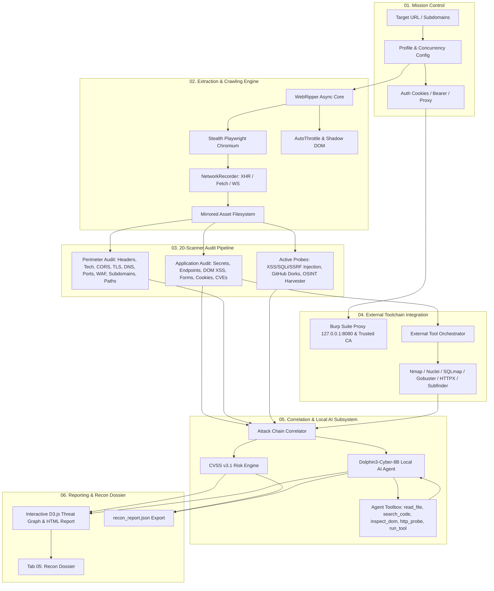

# WEBRIPPER RECON 5.0 — COMPREHENSIVE ARCHITECTURE & OPERATIONAL MANUAL

```
========================================================================================
██╗    ██╗███████╗██████╗ ██████╗ ██╗██████╗ ██████╗ ███████╗██████╗     ██████╗      ██████╗ 
██║    ██║██╔════╝██╔══██╗██╔══██╗██║██╔══██╗██╔══██╗██╔════╝██╔══██╗    ██╔════╝     ██╔═████╗
██║ █╗ ██║█████╗  ██████╔╝██████╔╝██║██████╔╝██████╔╝█████╗  ██████╔╝    ███████╗     ██║██╔██║
██║███╗██║██╔══╝  ██╔══██╗██╔══██╗██║██╔═══╝ ██╔═══╝ ██╔══╝  ██╔══██╗    ██╔═══██╗    ████╔╝██║
╚███╔███╔╝███████╗██████╔╝██║  ██║██║██║     ██║     ███████╗██║  ██║    ╚██████╔╝    ╚██████╔╝
 ╚══╝╚══╝ ╚══════╝╚═════╝ ╚═╝  ╚═╝╚═╝╚═╝     ╚═╝     ╚══════╝╚═╝  ╚═╝     ╚═════╝      ╚═════╝ 
========================================================================================
THE KINETIC MONOLITH // EDITORIAL BRUTALIST ADVANCED RECONNAISSANCE & AI PENTEST PLATFORM
========================================================================================
```

---

## 1. Executive Summary & Project Purpose

**WebRipper Recon 5.0** is an adversarial reconnaissance, static/dynamic security auditing, and autonomous AI vulnerability triage workstation for offensive security engineers, penetration testers, and bug bounty researchers.

### The Problem It Solves
Traditional penetration testing workflows are fragmented:
1. **Asset Mirroring:** Done via `wget`, `curl`, or custom scrapers that frequently crash on modern Single-Page Applications (SPAs), get blocked by anti-bot systems (Cloudflare, Akamai), or fail to capture dynamic client-rendered assets and background network traffic.
2. **Reconnaissance & Vulnerability Scanning:** Requires chaining dozens of disparate CLI tools (`nmap`, `nuclei`, `sqlmap`, `gobuster`, `httpx`, `subfinder`), managing complex flag syntax, and manually correlating disjointed outputs.
3. **Manual Analysis & Triage:** Security researchers spend hours manually grepping JavaScript bundles for leaked hardcoded API keys, inspecting CORS reflections, checking security headers, and constructing manual attack chains.
4. **AI Assistants in Security:** Commercial cloud LLMs (ChatGPT, Claude) refuse offensive security analysis due to overly aggressive alignment filters, and sending confidential corporate source code to external cloud APIs violates NDA / data privacy boundaries.

### The WebRipper Recon Solution
WebRipper Recon unifies this entire workflow into a single, high-density desktop application:
* **Stealth Dynamic Scraping:** Leverages anti-fingerprint Playwright browser automation, Shadow DOM extraction, network traffic recording, and adaptive autothrottling.
* **20-Scanner Security Audit Matrix:** Simultaneously executes passive static analysis and active vulnerability probes against mirrored files, headers, cookies, infrastructure, APIs, and network perimeter ports.
* **Integrated Security Toolchain:** 1-click automatic download, verification, and proxy routing for **Burp Suite Professional/Community, Nmap, Nuclei, SQLmap, Gobuster, HTTPX, and Subfinder**.
* **Attack Chain Correlation:** Automatically chains disparate findings (e.g. CORS misconfiguration + leaked API key in JS + exposed admin endpoint) into high-impact attack paths with CVSS v3.1 scoring.
* **Autonomous Local AI Pentesting Agent:** Deeply integrates an offline, uncensored local model (**`Dolphin3-Cyber-8B-GGUF`**) running on **Ollama** or any local OpenAI-compatible endpoint. The model has real tool-calling capabilities to read extracted files, search codebases, inspect live DOM trees via headless Chromium, execute security binaries, and probe live HTTP endpoints.
* **The Kinetic Monolith Interface:** An uncompromising, machined editorial brutalist design language engineered natively in **PySide6 (Qt)** with strict tonal layering, 0px border-radius, high-contrast indicators, non-blocking asynchronous threads, and zero emojis or AI slop.

---

## 2. High-Level Architectural Flow



---

## 3. Detailed Tour of the Codebase

### Repository Directory Structure
```
c:\Users\JAI\Desktop\webripper2.0\
├── main.py                          # Primary launch entrypoint (delegates to app.main)
├── app/
│   ├── __init__.py                  # Centralized package version (__version__ = "5.0.0")
│   ├── main.py                      # Application bootstrap, CLI argument parser & GUI launcher
│   ├── ui.py                        # PySide6 Kinetic Monolith GUI workstation (5 Tabs)
│   ├── worker.py                    # Multi-stage background worker thread (crawling + scanning)
│   ├── ripper.py                    # Core asynchronous web crawling and asset mirroring engine
│   ├── stealth.py                   # Anti-bot evasions, Playwright stealth flags, AutoThrottle
│   ├── correlator.py                # Multi-finding vulnerability correlator & attack chain builder
│   ├── cvss.py                      # CVSS v3.1 metrics calculation and overall risk grading
│   ├── models.py                    # Pydantic/dataclass data structures (RipperSettings, Finding, etc.)
│   ├── report.py                    # D3.js interactive HTML visualizer and JSON exporter
│   ├── dependencies.py              # Chromium runtime detection and Playwright installer
│   ├── history.py                   # SQLite local database tracking prior scans and targets
│   ├── assets/
│   │   └── check_black.png          # Generated high-contrast brutalist checkmark vector asset
│   ├── ai/
│   │   ├── __init__.py              # Subsystem exports
│   │   ├── agent.py                 # Multi-step autonomous ReAct loop with abort cancellation
│   │   ├── client.py                # Synchronous & streaming Ollama / OpenAI-compatible API client
│   │   ├── setup.py                 # Automated Ollama engine discovery and model configuration
│   │   └── tools.py                 # AgentToolbox (file reading, regex, browser DOM, probes, CLI tools)
│   ├── tools/
│   │   ├── __init__.py              # Tool module exports
│   │   ├── base.py                  # Base dataclass and interfaces for tool runners
│   │   ├── burp.py                  # Burp Suite detector, installer, CA cert fetcher & converter
│   │   ├── detector.py              # Detection logic across PATH and %APPDATA%/WebRipper/tools/
│   │   ├── installer.py             # Asynchronous GitHub release downloader with Zip Slip protection
│   │   └── runner.py                # Subprocess orchestration with timeout & port extraction
│   ├── scanners/
│   │   ├── base.py                  # Base scanner class with timing, progress callback, severity
│   │   ├── secrets.py               # Shannon entropy & regex for AWS keys, JWTs, OAuth tokens
│   │   ├── endpoints.py             # REST & hidden endpoint extraction from scripts and HTML
│   │   ├── javascript.py            # Static taint analysis for DOM XSS sinks (eval, innerHTML)
│   │   ├── forms.py                 # Form target auditing, password field exposure, CSRF tokens
│   │   ├── cookies.py               # Cookie security analysis (HttpOnly, Secure, SameSite)
│   │   ├── cves.py                  # Detected technology matching against public CVE databases
│   │   ├── headers.py               # Security header validation (HSTS, CSP, X-Frame-Options)
│   │   ├── tech.py                  # Web framework, CMS, CDN, and backend fingerprinting
│   │   ├── cors.py                  # Active origin reflection probing for CORS misconfiguration
│   │   ├── tls.py                   # SSL certificate expiry, deprecated TLS 1.0/1.1 protocols
│   │   ├── dns.py                   # A, AAAA, MX, TXT, CNAME analysis and subdomain takeover checks
│   │   ├── portscan.py              # Socket-based TCP port scanner with HTTP active probing
│   │   ├── waf.py                   # Fingerprints Cloudflare, AWS WAF, Akamai, Imperva
│   │   ├── subdomains.py            # DNS brute-force enumeration across common host prefixes
│   │   ├── paths.py                 # High-risk sensitive file fuzzing (.env, .git, /admin, backups)
│   │   ├── vulns.py                 # Active parameter reflection probing (XSS, SQLi, SSRF, LFI)
│   │   ├── github_dork.py           # GitHub Search API reconnaissance for domain-linked leaks
│   │   ├── emails.py                # Regex extraction of corporate emails and OSINT metadata
│   │   └── screenshots.py           # Playwright high-resolution full-page screenshot renderer
│   └── wordlists/
│       └── paths.py                 # Curated wordlists for path fuzzing and subdomain brute-forcing
└── tests/                           # 104 comprehensive unit and integration tests (100% pass)
    ├── test_ai_agent_and_tools.py
    ├── test_extraction.py
    ├── test_models.py
    ├── test_path_sanitize.py
    ├── test_scraper_enhanced.py
    └── test_ui_ux_features.py
```

---

## 4. Deep Dive into Core Subsystems

### 4.1 Crawling & Extraction Engine (`app/ripper.py` & `app/stealth.py`)
Inspired by modern high-performance web scrapers (such as Scrapling and Scrapy), WebRipper avoids naive fetching:
* **Stealth Playwright Chromium:** Uses headless Chromium patched with `--disable-blink-features=AutomationControlled`, customized user agents, realistic viewports, and JS evaluation hooks that delete `window.navigator.webdriver`.
* **Shadow DOM Extraction:** Recursively penetrates `shadowRoot` trees to extract closed and open web component DOM elements often missed by legacy HTML parsers.
* **Network Traffic Recorder (`NetworkRecorder`):** Intercepts background HTTP requests made by client-side JavaScript (Fetch/XHR/WebSocket), storing request/response payloads in memory and saving mirrored assets to disk.
* **AutoThrottle:** An adaptive concurrency regulator that monitors response latency and HTTP 429 status codes, applying exponential backoff and randomized jitter to evade WAF rate limits.
* **Path Sanitization & Security:** Strict directory traversal protection preventing malicious remote file names from writing outside `%APPDATA%/WebRipper/output/`.

### 4.2 The 20-Scanner Audit Pipeline (`app/scanners/`)
When WebRipper crawls a site, the mirrored files and live network endpoints are dispatched through 20 specialized audit scanners:

| Scanner | Target Area | What It Detects / How It Works |
| :--- | :--- | :--- |
| **`secrets.py`** | Application Code | Scans HTML/JS using high-entropy Shannon calculations and 30+ regexes for AWS keys, Google API tokens, JWTs, Slack webhooks, and private keys. |
| **`endpoints.py`** | API Discovery | Extracts hidden API routes (`/api/v1/...`, `/graphql`, `/admin/...`) embedded inside minified JavaScript bundles and source code. |
| **`javascript.py`** | Client Execution | Performs static taint analysis searching for dangerous JavaScript sinks (`eval()`, `innerHTML`, `document.write()`, `Function()`). |
| **`forms.py`** | Authentication / CSRF | Audits HTML `<form>` tags for unencrypted HTTP actions, missing CSRF tokens, and sensitive password inputs transmitted over plaintext. |
| **`cookies.py`** | Session Security | Analyzes `Set-Cookie` headers for missing `HttpOnly`, `Secure`, or strict `SameSite` flags. |
| **`cves.py`** | CVE Vulnerability Mapping | Takes technologies identified during fingerprinting and queries known vulnerability databases for unpatched CVE advisories. |
| **`headers.py`** | Perimeter Defense | Checks for absence or misconfiguration of `HSTS`, `Content-Security-Policy` (CSP), `X-Frame-Options` (Clickjacking), and `Permissions-Policy`. |
| **`tech.py`** | Fingerprinting | Inspects response headers (`Server`, `X-Powered-By`), DOM signatures, and script links to identify CMSs (WordPress, Drupal), frameworks (React, Laravel), and CDNs. |
| **`cors.py`** | Origin Probing | Sends active probes with custom `Origin: https://evil.com` and null origins to detect arbitrary origin reflection with `Access-Control-Allow-Credentials: true`. |
| **`tls.py`** | Encryption Standards | Audits SSL/TLS certificates for impending expiration, self-signed certificates, and deprecated SSLv3/TLS 1.0/1.1 protocols. |
| **`dns.py`** | DNS & Takeovers | Resolves A, AAAA, MX, TXT, CNAME, and SPF records. Specifically detects dangling CNAME pointers vulnerable to Subdomain Takeover (e.g. unclaimed S3, GitHub Pages). |
| **`portscan.py`** | TCP Perimeter | Rapid non-blocking socket scan across high-value ports (80, 443, 8080, 8443, 3000, 22, 21, 3306), grabbing service banners and issuing active HTTP probes. |
| **`waf.py`** | Evasion Profiling | Sends benign trigger signatures to fingerprint active Web Application Firewalls (Cloudflare, AWS WAF, Akamai, Imperva) and advises evasion tactics. |
| **`subdomains.py`** | Host Enumeration | Resolves a curated wordlist of high-value subdomain prefixes (`api`, `dev`, `stage`, `admin`, `vpn`, `auth`, `internal`) against the target domain. |
| **`paths.py`** | Sensitive File Fuzzing | Actively probes for high-risk files (`.env`, `.git/config`, `wp-config.php`, `backup.sql`, `phpinfo.php`, `/admin/login`). |
| **`vulns.py`** | Active Exploitation | Injects benign verification probes into URL query parameters to detect Reflected XSS, SQL injection error responses, Open Redirects, and Local File Inclusion (LFI). |
| **`github_dork.py`** | Public OSINT | Generates targeted GitHub search dork URLs to identify third-party public repositories accidentally leaking code or credentials belonging to the target domain. |
| **`emails.py`** | Social Engineering | Extracts corporate email addresses, author tags, and employee metadata from mirrored documents and code files. |
| **`screenshots.py`** | Visual Recon | Uses Playwright to render high-resolution PNG screenshots of target web pages for visual reconnaissance and report generation. |
| **`External Tools`**| CLI Integration | Executes installed external tools (Nmap, Nuclei, etc.) and integrates their findings directly into the report. |

### 4.3 Tool Management & Integration Hub (`app/tools/`)
WebRipper Recon manages and coordinates third-party offensive security binaries:
* **Burp Suite Professional / Community (`app/tools/burp.py`):**
  * Auto-detects local installations across common Windows paths and system `PATH`.
  * Provides 1-click download of the official PortSwigger installer if missing.
  * **Automated Root CA Trust:** Pulls PortSwigger's root CA directly from `http://127.0.0.1:8080/cert`, converts DER format to PEM, and stores it in the WebRipper certificate store.
  * **1-Click Upstream Proxy Routing:** Sets `http://127.0.0.1:8080` as the proxy for both Python HTTP requests and Playwright Chromium sessions.
* **Portable Tool Installer (`app/tools/installer.py`):**
  * Asynchronously downloads latest official releases from GitHub (`nuclei`, `gobuster`, `httpx`, `subfinder`) and Python packages (`sqlmap`).
  * Features **Zip Slip Protection** (`_safe_extract_zip`), strictly validating that extracted file paths do not escape target directories.
  * Automatically updates Nuclei vulnerability templates (`nuclei -update-templates`) upon download.
  * Automatically supports both `x86_64` and `amd64` architecture tags on Windows.
* **Asynchronous Tool Execution (`ToolInstallerThread`):**
  * All downloads and installations run in background `QThread` workers with Qt signal/slot telemetry. The GUI never blocks, turns white, or displays Windows "Not Responding" warnings.

### 4.4 Local AI Agent Subsystem (`Dolphin3-Cyber-8B-GGUF`) (`app/ai/`)
WebRipper Recon features an integrated, fully offline autonomous cybersecurity agent specifically designed to run on a local 8B parameter model (`Dolphin3-Cyber-8B-GGUF`):
* **Why Dolphin3-Cyber-8B?** It is an uncensored, offensive-security fine-tuned model trained on exploit analysis, vulnerability classification, and technical remediation without arbitrary cloud safety refusals.
* **Ollama Client (`app/ai/client.py`):**
  * Connects to Ollama (`http://127.0.0.1:11434`) or any OpenAI-compatible server (LM Studio, vLLM, llama.cpp on `127.0.0.1:1234/v1`).
  * Provides a low-latency non-blocking ping probe (`ping()`), dynamic model listing, and 1-click streaming model pulling from Hugging Face (`hf.co/bartowski/Dolphin3-Cyber-8B-GGUF:Q4_K_M`).
* **The ReAct Agent Loop (`app/ai/agent.py`):**
  * Implements Reasoning + Acting (ReAct) with thought scratchpads.
  * Features an **Abort Cancellation Token** (`self._is_aborted`), allowing the operator to immediately halt the agent between tool invocations without locking the GPU or Python process.
* **The Agent Toolbox (`app/ai/tools.py`):**
  The model is granted 6 live tools:
  1. `read_file(path, max_lines)`: Safely reads files from the mirrored target directory.
  2. `search_code(query, extension)`: Fast regex search across all mirrored target assets.
  3. `inspect_web_page(url)`: Launches headless stealth Chromium to render a target page and dump its live DOM structure.
  4. `http_probe(url, method, headers, data)`: Dispatches active HTTP probes directly to the target (or routes through Burp Suite).
  5. `run_security_tool(tool, args)`: Executes external CLI binaries (`nuclei`, `nmap`, `httpx`, `subfinder`, `gobuster`, `sqlmap`) and returns stdout.
  6. `get_scan_findings()`: Returns structured findings and attack chains from memory, or automatically falls back to reading `recon_report.json` from disk.

### 4.5 Attack Chain Correlator & CVSS Engine (`app/correlator.py` & `app/cvss.py`)
Rather than presenting isolated, noisy alerts, WebRipper's correlation engine matches multiple lower-severity findings to construct realistic multi-stage attack scenarios:
* **Example Attack Chains:**
  * `EXPOSED_API_CREDENTIALS`: Hardcoded API Key + Leaked Endpoint -> Unauthorized Data Extraction.
  * `CORS_AUTHENTICATED_THEFT`: CORS Wildcard Origin + Weak Cookie Flags -> Cross-Origin Session Hijacking.
  * `DOM_XSS_SESSION_TAKEOVER`: Vulnerable `eval()` / `innerHTML` sink + Missing `HttpOnly` on session cookie -> Full Account Takeover.
* **Risk Score:** Computes an overall organizational letter grade (`A` through `F`) based on CVSS v3.1 base score metrics.

---

## 5. The User Interface: "The Kinetic Monolith"

The GUI ([`app/ui.py`](file:///c:/Users/JAI/Desktop/webripper2.0/app/ui.py)) implements **The Kinetic Monolith** design specification:
* **Strict Monochromatic Palette:** Canvas (`#101010`), Deep Recess (`#0A0A0A`), Surface Plates (`#181818`), Elevated Plates (`#222222`), Primary Action (`#FFFFFF`), Danger (`#93000A`).
* **High-Density Brutalism:** 0px border-radius globally, architectural tonal layering, crisp borders, and zero decorative emojis or icons.
* **High-Contrast Indicators:**
  * **Unchecked Checkbox:** 18×18px recessed box (`#0A0A0A`) with a bold `2px solid #555555` border.
  * **Checked Checkbox:** Solid bright white plate (`#FFFFFF`) with a vector jet-black checkmark (`check_black.png`) and bold white text.
* **Process Lifecycle Teardown (`closeEvent`):**
  * Cleanly aborts any active crawler threads (`RipperWorker`), terminates active AI inference queries (`AgentWorkerThread`), and joins background tool downloaders. No orphaned Python or Ollama processes are left behind on exit.

### The Five Primary Workspaces

```
┌────────────────────────────────────────────────────────────────────────────────────────┐
│ [01] MISSION CONTROL │ [02] AUDIT MATRIX │ [03] INTEGRATION HUB │ [04] CYBER AGENT │ [05] DOSSIER │
├────────────────────────────────────────────────────────────────────────────────────────┤
│ • Target URL & Directory                 • Burp Suite Status & CA Sync                 │
│ • Audit Profile (Quick/Std/Aggressive)    • Nmap & Portable Toolchain (Nuclei, SQLmap)  │
│ • Workers, Depth, Timeout, Max Files     • Local Ollama AI Workstation (Dolphin3-Cyber)│
│ • Live Telemetry & Console Log           • Correlated Attack Chains & HTML Report      │
└────────────────────────────────────────────────────────────────────────────────────────┘
```

#### Workspace 01 // MISSION CONTROL
* **Target Identifier:** Primary target URL (e.g. `https://target.com`).
* **Audit Profile Selector:**
  * `01 // QUICK (PASSIVE & SURFACE RECON)`: Static asset analysis, zero active payloads, near-zero WAF footprint.
  * `02 // STANDARD (BALANCED AUDIT - RECOMMENDED)`: Passive recon + non-destructive active probes (CORS, cookies, CVE match, portscan).
  * `03 // AGGRESSIVE (DEEP ENUMERATION & ACTIVE FUZZING)`: Full active injection testing (XSS/SQLi/SSRF/LFI), directory fuzzing, and complete port sweeps.
* **Dynamic Implication Banner:** Displays real-time operational risk and noise footprint whenever the profile changes.
* **Concurrency Controls with Explanations:**
  * **Workers (1–50):** 1–3 for Stealth/Low WAF risk, 5–10 for Balanced throughput, 20+ for Aggressive/Rate-limit risk.
  * **Depth (1–10):** 1 for Root only, 2 for Root + 1st degree links (Recommended), 3+ for Recursive deep crawling.
  * **Max Files:** Circuit breaker preventing infinite crawler loops on dynamic web applications.
  * **Timeout (5–120s):** Per-request latency ceiling before dropping unresponsive endpoints.
* **Crawl Evasion Flags:** Same Origin Confinement, Stealth Playwright, Robots.txt compliance, and Automatic AI Summary generation.

#### Workspace 02 // AUDIT MATRIX
* **Quick Presets:** `[ ALL 20 SCANNERS ]`, `[ RECOMMENDED (STANDARD) ]`, `[ PASSIVE ONLY (STEALTH) ]`, `[ CLEAR ALL ]`.
* **Categorized Modules:**
  * **Application Audit:** Secrets, Endpoints, DOM XSS, Forms, Cookies, CVE Mapper.
  * **Perimeter Audit:** Security Headers, Tech Fingerprinting, CORS Probes, TLS Ciphers, DNS Records, TCP Ports, WAF Probing, Subdomain Brute-Forcing, Sensitive Paths.
  * **Active Probes:** Active Parameter Injections, GitHub Leak Dorks, OSINT Harvester, Full Page Screenshots, External Tool Integration.
* **Authentication Injection & Proxy:** Injected Cookie header, Bearer token, Upstream Proxy (`http://127.0.0.1:8080`), and Multi-Target batch scanning list.

#### Workspace 03 // INTEGRATION HUB
* **Featured Engines:**
  * **Burp Suite:** Real-time proxy detection (`[LISTENING // 127.0.0.1:8080]`), 1-click PortSwigger download, Trust CA certificate fetcher, and 1-click proxy routing.
  * **Nmap Network Scanner:** Detection and installer download.
* **Portable Toolchain Grid:** Compact 2-column layout displaying **Nuclei, SQLmap, Gobuster, HTTPX, and Subfinder** with status badges (`[INSTALLED // READY]` vs `[MISSING]`).
* **Non-Blocking Batch Actions:** `[ INSTALL ALL MISSING TOOLS ]` with an active progress bar and `[ ABORT INSTALLATION ]` button.

#### Workspace 04 // CYBER AGENT
* **Endpoint & Connection Deck:** Editable Ollama / OpenAI endpoint (default `http://127.0.0.1:11434`), `[ TEST CONNECTION / PING ]` button with millisecond latency readout, model selector dropdown, and `[ PULL DOLPHIN3-CYBER-8B ]` action.
* **Staged Autonomous Missions:**
  * `1. TRIAGE ALL FINDINGS`: Analyzes scan results, eliminates false positives, and calculates business impact.
  * `2. AUDIT AUTHENTICATION & APIS`: Inspects mirrored JS and network logs for auth bypasses and leaked API keys.
  * `3. VERIFY ATTACK CHAINS`: Generates step-by-step reproduction instructions and PoC exploit scripts.
  * `4. SYNTHESIZE EXECUTIVE REPORT`: Writes an executive threat assessment and technical remediation roadmap.
  * **The Staging Workflow:** Clicking any preset does **not** auto-dispatch immediately; it stages the prompt in the editor, displays `[PROMPT STAGED: REVIEW OR CUSTOMIZE BELOW]`, and allows the operator to review and edit before clicking `[ DISPATCH MISSION ]`.
* **Real-time Terminal Stream:** Live execution console displaying `[THOUGHT]`, `[ACTION]`, `[OBSERVATION]`, and `[FINAL ANALYSIS]` blocks. Includes an immediate `[ ABORT MISSION ]` button.

#### Workspace 05 // RECON DOSSIER
* **Monolithic Risk Metrics:** Large Risk Grade (`A` through `F`), Severity distribution (`CRITICAL // HIGH // MEDIUM // LOW // INFO`), and total attack chains count.
* **Actions:** `[ VIEW HTML REPORT ]` (opens interactive D3.js report in browser), `[ BROWSE MIRRORED FILES ]` (opens local directory in Windows Explorer).
* **Consolidated Dossier Feed:** Formatted text output of all correlated attack chains and critical/high vulnerabilities.

---

## 6. End-to-End Operational Workflow

### Typical Security Audit Walkthrough

```
Step 1: LAUNCH & VERIFY ENGINE
  └─ Start WebRipper Recon (py main.py)
  └─ Tab 03: Click [SYNC STATUS] or [INSTALL ALL MISSING TOOLS] to ensure Nuclei/HTTPX/etc. are ready.
  └─ Tab 04: Click [TEST CONNECTION / PING] to ensure Ollama (Dolphin3-Cyber-8B) is online.

Step 2: CONFIGURE TARGET IN MISSION CONTROL
  └─ Tab 01: Enter target URL (e.g. https://example.com).
  └─ Select Audit Profile: STANDARD (Balanced) or AGGRESSIVE (Active Fuzzing).
  └─ Check Concurrency: Workers (10), Depth (2), Max Files (500), Timeout (15s).
  └─ (Optional) Tab 02: Add session Cookie or Bearer token for authenticated scanning.
  └─ Click [ EXECUTE RECONNAISSANCE ].

Step 3: AUTOMATED RECON & SCANNING
  └─ Phase 1: Stealth Playwright mirrors HTML, JS, CSS, images, and background Fetch/XHR traffic.
  └─ Phase 2: 20 Scanners audit mirrored files and endpoints for secrets, DOM XSS, CORS, CVEs, etc.
  └─ Phase 3: External tools (Nmap/Nuclei) execute if enabled.
  └─ Phase 4: Attack Chain Correlator connects findings into multi-stage exploit paths.
  └─ Phase 5: Dolphin3-Cyber-8B writes an executive threat narrative.
  └─ UI automatically switches to Tab 05 (Recon Dossier) with Risk Grade and findings summary.

Step 4: AUTONOMOUS AI INVESTIGATION
  └─ Tab 04 (Cyber Agent): Click [1. TRIAGE ALL FINDINGS] or [3. VERIFY ATTACK CHAINS].
  └─ Prompt stages in editor. Add custom scope constraints if desired.
  └─ Click [ DISPATCH MISSION ].
  └─ Agent uses tools (search_code, read_file, http_probe, inspect_web_page) to verify vulnerabilities.
  └─ Review live reasoning and exploit scenarios in the terminal stream.

Step 5: REPORT EXPORT & REMEDIATION
  └─ Tab 05: Click [ VIEW HTML REPORT ] to inspect the interactive D3.js force-directed graph.
  └─ Share recon_report.html and recon_report.json with stakeholders.
```

---

## 7. Installation & Setup Prerequisites

### System Requirements
* **Operating System:** Windows 10/11 64-bit (macOS/Linux compatible CLI/engine)
* **Python Runtime:** Python 3.10 – 3.14 (64-bit)
* **Hardware for Local AI:** 16 GB+ RAM (NVIDIA GPU with 8 GB+ VRAM recommended for fast 8B GGUF inference, or CPU with AVX2)

### Automated Setup
1. **Clone the repository:**
   ```powershell
   git clone https://github.com/your-org/webripper2.0.git
   cd webripper2.0
   ```

2. **Install Python dependencies:**
   ```powershell
   py -m pip install -r requirements.txt
   ```

3. **Install Playwright Browsers:**
   ```powershell
   py -m playwright install chromium
   ```

4. **Install Ollama & Dolphin3-Cyber:**
   * Download and install Ollama from [ollama.com](https://ollama.com).
   * Pull the recommended cybersecurity model:
     ```powershell
     ollama pull hf.co/bartowski/Dolphin3-Cyber-8B-GGUF:Q4_K_M
     ```
     *(Or pull directly within WebRipper Recon's Tab 04 by clicking `[ PULL DOLPHIN3-CYBER-8B ]`)*

5. **Launch WebRipper Recon:**
   ```powershell
   py main.py
   ```

---

## 8. Testing & Quality Assurance

The codebase includes a comprehensive pytest suite covering all scanners, data models, path sanitization, AI tools, and UI/UX threads:

```powershell
# Run the complete test suite
py -m pytest
```

### Test Suite Status
* **104 unit & integration tests passing** in under 4 seconds.
* Tests verify:
  * Checkbox asset generation & QSS stylesheet binding.
  * Agent abort cancellation token behavior.
  * Low-latency Ollama ping and dynamic model switching.
  * Asynchronous mission staging (ensuring presets do not fire prematurely).
  * URL path traversal sanitization and Zip Slip archive protection.
  * Stealth Playwright integration and DOM extraction.

---

## 9. Security & Legal Notice

WebRipper Recon is designed strictly for **authorized security audits, penetration tests, and defensive vulnerability assessments** on networks and web applications owned by you or where you possess explicit, written permission from the target owner. 

Adversarial reconnaissance and vulnerability probing against unauthorized targets without prior consent is illegal under the Computer Fraud and Abuse Act (CFAA), UK Computer Misuse Act, and equivalent international cybersecurity legislation.

---
*WebRipper Recon 5.0 — The Kinetic Monolith // Engineered for High-Density Operational Precision.*

