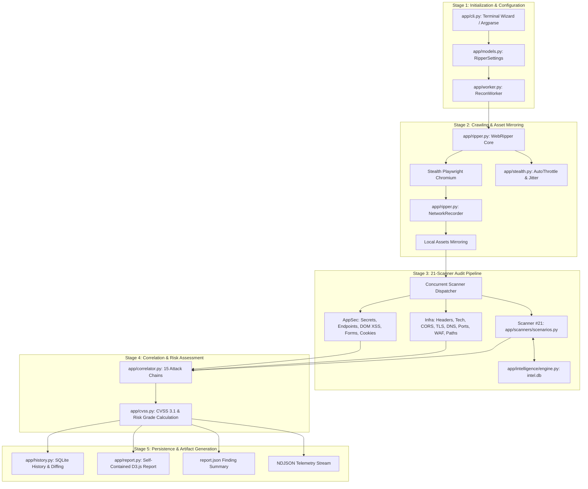

# WebRipper Recon 5.0 — System Architecture Specification

## 1. Architectural Philosophy & Design Goals

WebRipper Recon 5.0 is engineered as a **pure-CLI, agent-native security reconnaissance engine**. It rejects heavyweight desktop GUI frameworks in favor of a modular, headless pipeline optimized for:
1. **Programmatic Orchestration**: Seamless integration with autonomous AI coding agents (Claude Code, Cursor, Antigravity) via JSON-RPC 2.0 Model Context Protocol (MCP) and NDJSON streaming.
2. **Stealth & Anti-Fingerprinting**: Intelligent browser automation that mimics human navigation patterns, bypasses automated detection, and dynamically throttles requests.
3. **Comprehensive Vulnerability Coverage**: A 21-scanner audit matrix evaluating application logic, infrastructure perimeter, cryptographic standards, and real-world exploit scenarios.
4. **Offline Intelligence**: Instant full-text search across 30,297 bug bounty records and exploit recipes without external network dependencies.
5. **Correlation-First Reporting**: Connecting isolated, lower-severity signals into high-impact multi-stage attack chains with CVSS 3.1 scoring.

---

## 2. Multi-Stage Pipeline Execution Flow

---

## 3. Subsystem Breakdown

### 3.1 Core Crawler & Extraction Engine (`app/ripper.py`, `app/stealth.py`)
- **Async Concurrency**: Built on `asyncio` and `playwright.async_api`. Uses concurrency semaphores to regulate parallel page downloads.
- **Stealth Evasion Flags**: Headless Chromium is initialized with custom arguments:
  - `--disable-blink-features=AutomationControlled`
  - Realistic user-agent strings rotated from common modern browsers.
  - Runtime evaluation scripts removing `window.navigator.webdriver`.
- **Shadow DOM Penetration**: Recursively traverses open and closed shadow roots to locate hidden inputs, links, and components.
- **Network Traffic Recorder**: Intercepts in-flight XHR, Fetch, and WebSocket events, capturing headers, payloads, and dynamic response bodies.
- **Adaptive AutoThrottle**: Regulates pacing using moving average response latencies and backoff triggers upon encountering HTTP 429 status codes.

### 3.2 21-Scanner Security Audit Pipeline (`app/scanners/`)
All scanners inherit from `BaseScanner` (`app/scanners/base.py`) providing standard timing, progress callback dispatching, and normalized finding formats:
1. `scenarios.py` (Scanner #21): Queries `app/intelligence/` for technology-targeted recipes and fires 15–20 non-destructive verification canary probes.
2. `tech.py`: Detects servers, web frameworks, CDNs, and passive Favicon MD5 hash fingerprints.
3. `secrets.py`: High-entropy Shannon evaluation and 30+ regex patterns for API keys and tokens.
4. `endpoints.py`: Regex extraction of REST, GraphQL, and internal Next.js/React endpoints from scripts.
5. `javascript.py`: Taint analysis searching for dangerous DOM sinks (`eval`, `innerHTML`, `document.write`).
6. `forms.py`: Audits forms for missing CSRF tokens, unencrypted HTTP submission, and plaintext passwords.
7. `cookies.py`: Checks `Set-Cookie` attributes (`HttpOnly`, `Secure`, `SameSite`).
8. `cves.py`: Maps identified versions against known CVE advisories.
9. `headers.py`: Validates `HSTS`, `CSP`, `X-Frame-Options`, and `Permissions-Policy`.
10. `cors.py`: Sends active probes (`Origin: https://evil.com` and `null`) checking for credentialed reflection.
11. `tls.py`: Analyzes SSL/TLS certificates and checks for deprecated protocols (TLS 1.0/1.1).
12. `dns.py`: Enumerates DNS records and identifies dangling CNAME pointers vulnerable to takeover.
13. `portscan.py`: Non-blocking socket port scanner across high-value ports (80, 443, 8080, 8443, 3000, 22, 3306).
14. `waf.py`: Fingerprints active Web Application Firewalls (Cloudflare, AWS WAF, Akamai, Imperva).
15. `subdomains.py`: Resolves common subdomain prefixes against target base domains.
16. `paths.py`: Actively probes for high-risk files (`.env`, `.git/config`, `backup.sql`, `/admin`).
17. `vulns.py`: Active benign injection probes for Reflected XSS, SQLi errors, Open Redirects, and SSRF.
18. `github_dork.py`: Prepares targeted GitHub search queries for exposed domain credentials.
19. `emails.py`: Extracts corporate email addresses and author metadata for OSINT scoping.
20. `screenshots.py`: Renders high-resolution full-page PNG screenshots via Playwright.
21. `External Tools`: Orchestrates external CLI tools (Nmap, Nuclei, SQLmap, Gobuster, HTTPX, Subfinder).

### 3.3 Attack Chain Correlator (`app/correlator.py`)
Analyzes the global finding set to detect multi-step attack scenarios. When multiple complementary weaknesses exist (such as an exposed `.git` directory + hardcoded database credentials + an open database port), the correlator synthesizes a composite `AttackChain` with aggregate severity, exploit timeline, and actionable remediation steps.

### 3.4 Risk Scoring & CVSS 3.1 Calculator (`app/cvss.py`)
Computes an overall security grade (`A` through `F`) using CVSS v3.1 base score metrics:
- **Grade A** (Score 0.0 – 2.0): Excellent security posture; only low or informational findings.
- **Grade B** (Score 2.1 – 4.0): Minor configuration issues; no direct attack vectors.
- **Grade C** (Score 4.1 – 6.0): Moderate risk; missing headers, weak cookie flags, or CORS reflection without credentials.
- **Grade D** (Score 6.1 – 8.0): High risk; exposed admin interfaces, sensitive endpoints, or missing CSRF tokens on critical actions.
- **Grade F** (Score 8.1 – 10.0): Critical risk; exposed secrets, confirmed injection vectors, or executable attack chains.

---

## 4. Concurrency & Resource Governance
- **Semaphore-Controlled Concurrency**: Default 10 concurrent requests; adjustable via `--profile` or `--workers`.
- **Memory Ceiling**: Mirrored assets are streamed directly to disk; response bodies in memory are capped to prevent out-of-memory errors on large assets.
- **Rate Limit Resilience**: The `AutoThrottle` algorithm automatically increases inter-request delay upon receiving HTTP 429 responses, preventing scanner blacklisting.
