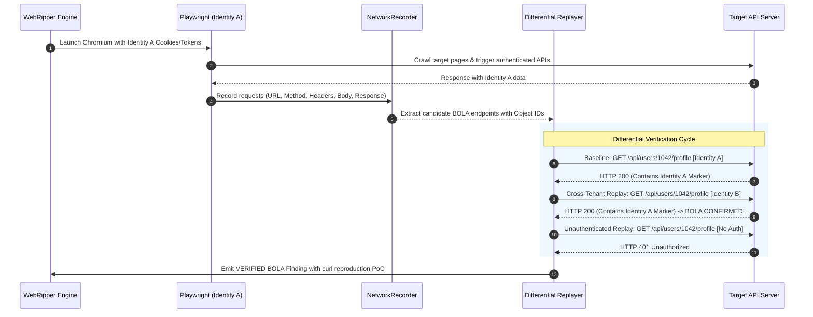
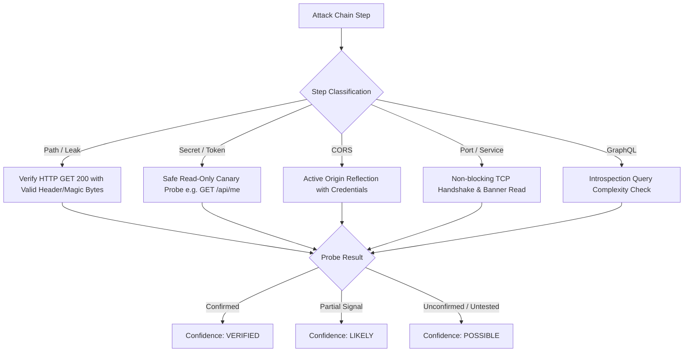
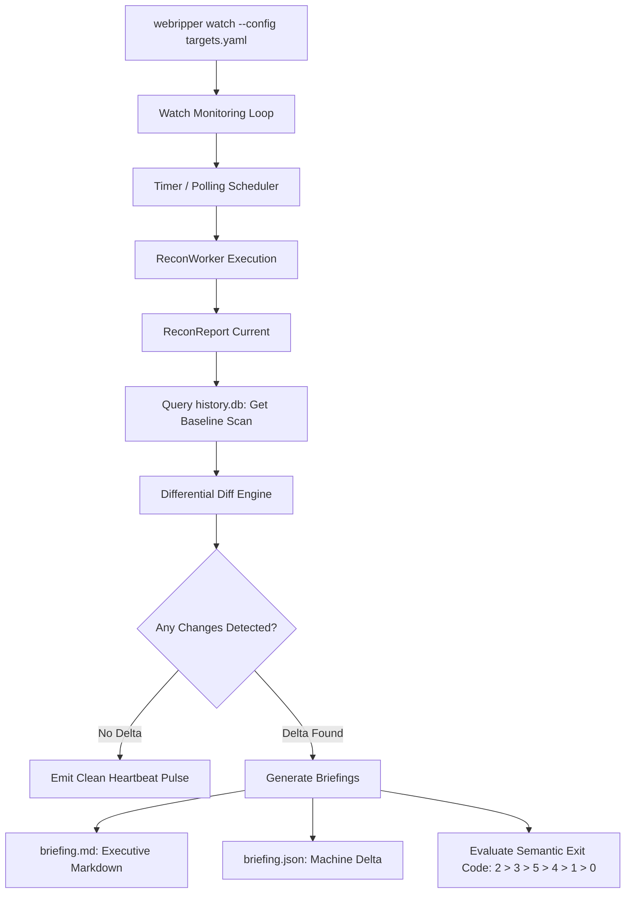

# WebRipper Recon 5.0 — Phases 2, 3, 4 & 8 Technical Architecture Specification

```
========================================================================================
WEBRIPPER RECON 5.0 — ADVANCED CAPABILITIES ARCHITECTURE SPECIFICATION
Phases Covered: Phase 2 (Deduplication), Phase 3 (Dual-Identity BOLA/IDOR/BFLA),
                Phase 4 (Validated Attack Chains), Phase 8 (Continuous Diff Watch Mode)
========================================================================================
```

## Executive Summary & System Invariants

This specification provides the engineering blueprint, algorithmic designs, data contracts, and implementation interfaces for four advanced capability phases of **WebRipper Recon 5.0**:

1. **Phase 2 — Deduplication & Submission-Quality Guard**: 64-bit SimHash locality-sensitive clustering over finding titles, normalized evidence, and parameterized endpoint shapes, combined with duplicate risk scoring against the 30,297-record `intel.db` HackerOne disclosure database, producing grouped finding representations.
2. **Phase 3 — Dual-Identity Differential Engine (BOLA/IDOR & BFLA)**: Multi-identity crawl recording and non-destructive differential replay across Identity A, Identity B, and Anonymous contexts to detect Broken Object Level Authorization (IDOR) and Broken Function Level Authorization (BFLA) using status code matrices, content similarity, and tenant ownership markers.
3. **Phase 4 — Validated Attack Chains**: Active non-destructive read-only step verification for the 15 correlated attack paths generated by `correlator.py`, governed by the strict *weakest-link rule* ($Confidence(Chain) = \min_{s}(Confidence(s))$) to eliminate false-positive panic and distinguish verified exploits from hypothetical scenarios.
4. **Phase 8 — Continuous Diff Briefings / Watch Mode**: Automated continuous attack surface monitoring (`webripper watch`), configuration-driven polling, historical diffing via `history.py`, change-only executive Markdown/JSON briefings, and Model Context Protocol (MCP) tool bindings.

### Core Architectural Invariants

All designs and code implementations specified herein MUST adhere to the following invariants:
* **Python 3.11+ Pure Headless Engine**: Zero Qt / PySide GUI dependencies; clean execution in headless Docker containers, CI/CD runners, and AI agent sandboxes.
* **Python 3.11 f-string Compliance**: No backslashes within f-string curly brace expressions (`{...}`). All path or character sanitization must occur in temporary variables prior to interpolation.
* **Deterministic Semantic Exit Codes**: Strict priority evaluation order:
  $$\text{Exit Code Priority: } 2 \text{ (Critical/High)} > 3 \text{ (Unreachable)} > 5 \text{ (WAF Blocked)} > 4 \text{ (Rate Limited)} > 1 \text{ (Fatal Error)} > 0 \text{ (Clean)}$$
* **Non-Breaking Schema Compatibility**: Complete backward compatibility with existing dataclasses (`RipperSettings`, `Finding`, `AttackChain`, `ReconReport`, `ScanResult`). All additions to existing classes use optional fields with default values; auxiliary telemetry is persisted under `metadata`.
* **Deterministic Computations**: Locality-sensitive hashing, string tokenization, risk scoring, and diffing algorithms must be deterministic across platforms, operating systems, and process restarts (no non-seeded hashes or non-deterministic dictionary iterations).

---

## 1. System Pipeline & Integration Hooks

```mermaid
flowchart TD
    subgraph PHASE_3 [Phase 3: Dual-Identity Differential Engine]
        Settings[RipperSettings: identity_a & identity_b credentials] --> CrawlerA[Playwright Crawler: Authenticated as Identity A]
        CrawlerA --> NetRec[NetworkRecorder: Captured Requests with Object IDs]
        NetRec --> ObjExtract[Object ID & Parameter Extractor]
        ObjExtract --> DiffReplay[Differential Replay: Replay as B & Anonymous]
        DiffReplay --> AuthFindings[IDOR / BOLA / BFLA Findings]
    end

    subgraph SCAN_MATRIX [Standard 21-Scanner Matrix]
        StaticScanners[Static & Passive Scanners]
        ActiveScanners[Active Probes & Scenario Canary #21]
    end

    subgraph PHASE_2 [Phase 2: Deduplication & Submission Quality]
        AuthFindings & StaticScanners & ActiveScanners --> RawFindings[Raw Finding Stream]
        RawFindings --> SimHashEngine[SimHash 64-bit Engine: Title + Evidence + Endpoint Shape]
        SimHashEngine --> ClusterBuckets[Hamming Distance Clustering: <= 4 bits]
        ClusterBuckets --> IntelDBScorer[Duplicate Risk Scoring: intel.db FTS5 & h1_disclosures]
        IntelDBScorer --> GroupedFindings[Submission-Quality Grouped Findings]
    end

    subgraph PHASE_4 [Phase 4: Validated Attack Chains]
        GroupedFindings --> Correlator[app/correlator.py: 15 Attack Chains]
        Correlator --> StepVerifier[Non-Destructive Read-Only Step Verifier]
        StepVerifier --> WeakestLink[Weakest-Link Confidence Rule: min(step.confidence)]
        WeakestLink --> FinalChains[Validated & Hypothetical Attack Chains]
    end

    subgraph PHASE_8 [Phase 8: Continuous Diff Watch Mode]
        FinalChains --> HistoryDB[app/history.py: SQLite Persistence]
        HistoryDB --> DiffEngine[Differential Engine: Previous Scan vs Current Scan]
        DiffEngine --> BriefingMD[Change-Only Markdown Briefing]
        DiffEngine --> BriefingJSON[Change-Only JSON Delta Briefing]
        BriefingJSON --> MCPWatch[MCP Tools: webripper_watch_poll, webripper_diff_scans]
    end
```

---

## 2. Phase 2 — Deduplication & Submission-Quality Guard

### 2.1 The Submission-Quality Problem in Automated Recon

Automated web application security scanners frequently overwhelm triagers and bug bounty platforms with repetitive findings:
1. **Parameterized Route Explosion**: A missing security header or reflected CORS header on an API route like `/api/v1/users/1/profile`, `/api/v1/users/2/profile`, ..., `/api/v1/users/500/profile` produces 500 identical findings.
2. **Duplicate Disclosures**: Security researchers often waste hours reporting known issues or reporting vulnerabilities that programs have already resolved or categorized as accepted risk on HackerOne.
3. **Triager Fatigue**: Automated reports lacking non-destructive proof or bundling 50 locations into 50 tickets are routinely marked as spam, low signal, or closed as duplicate.

Phase 2 introduces a **Submission-Quality Guard** that clusters near-duplicate findings using 64-bit SimHash locality-sensitive hashing, evaluates duplicate risk against 30,297 real-world disclosures in `app/intelligence/intel.db`, and collapses repetitive findings into unified grouped finding representations.

---

### 2.2 SimHash Algorithmic Design

SimHash is a locality-sensitive hash function with the property that the Hamming distance between the hashes of two documents is inversely proportional to their cosine similarity.

#### 2.2.1 Feature Extraction & Endpoint Shape Normalization

To accurately cluster findings across parameterized URLs, endpoint URLs must be transformed into their **structural shape**:
* Hexadecimal hashes, MD5/SHA sums, and UUIDs are collapsed to `{uuid}` or `{hash}`.
* Integer identifiers in path segments are collapsed to `{id}`.
* Query string parameter values are collapsed to parameter names in sorted order.

```python
import re
from urllib.parse import urlparse, parse_qsl

_RE_UUID = re.compile(r"^[0-9a-f]{8}-[0-9a-f]{4}-[0-9a-f]{4}-[0-9a-f]{4}-[0-9a-f]{12}$", re.I)
_RE_HASH = re.compile(r"^[0-9a-f]{16,64}$", re.I)
_RE_INT = re.compile(r"^\d+$")

def extract_endpoint_shape(url: str) -> str:
    """Normalize a URL into its structural endpoint shape for clustering."""
    if not url:
        return "root"
    parsed = urlparse(url)
    segments = [s for s in parsed.path.split("/") if s]
    shape_segments = []
    for seg in segments:
        if _RE_INT.match(seg):
            shape_segments.append("{id}")
        elif _RE_UUID.match(seg):
            shape_segments.append("{uuid}")
        elif _RE_HASH.match(seg):
            shape_segments.append("{hash}")
        else:
            shape_segments.append(seg.lower())
    
    path_shape = "/" + "/".join(shape_segments)
    if parsed.query:
        # Extract parameter keys in deterministic sorted order
        query_keys = sorted(k.lower() for k, _ in parse_qsl(parsed.query))
        query_shape = "?" + "&".join(query_keys)
    else:
        query_shape = ""
    return f"{parsed.netloc.lower()}{path_shape}{query_shape}"
```

#### 2.2.2 64-bit SimHash Vector Accumulation

The SimHash calculation over finding features utilizes deterministic 64-bit hashing (`hashlib.sha256` truncated to 64 bits) to ensure platform-independent, cross-process consistency:

1. **Features**:
   * Title tokens: Weight = 3
   * Endpoint shape: Weight = 3
   * Category: Weight = 2
   * Evidence 3-gram shingles (whitespace-normalized, truncated to 200 chars): Weight = 1
2. **Vector Accumulation**: An array of 64 integer counters $V = [v_0, v_1, \dots, v_{63}]$ initialized to 0. For each feature $f$ with weight $w$:
   * Compute deterministic 64-bit hash $h(f)$.
   * For bit $i \in [0, 63]$: if the $i$-th bit of $h(f)$ is 1, $v_i \leftarrow v_i + w$; otherwise $v_i \leftarrow v_i - w$.
3. **SimHash Assembly**: The final 64-bit fingerprint has its $i$-th bit set to 1 if $v_i > 0$, and 0 otherwise.

```python
import hashlib
from typing import List, Tuple

def _fnv64(token: str) -> int:
    """Deterministic 64-bit unsigned integer hash derived from SHA-256."""
    digest = hashlib.sha256(token.encode("utf-8")).digest()
    return int.from_bytes(digest[:8], byteorder="big", signed=False)

def compute_finding_simhash(category: str, title: str, endpoint_shape: str, evidence: str) -> int:
    """Compute a deterministic 64-bit SimHash locality-sensitive fingerprint."""
    v = [0] * 64
    features: List[Tuple[str, int]] = []

    # Category weight = 2
    features.append((f"cat:{category.lower().strip()}", 2))

    # Title tokens weight = 3
    for tok in re.findall(r"\w+", title.lower()):
        features.append((f"title:{tok}", 3))

    # Endpoint shape weight = 3
    features.append((f"shape:{endpoint_shape}", 3))

    # Evidence shingle features weight = 1
    clean_ev = re.sub(r"\s+", " ", evidence.strip().lower())[:200]
    words = clean_ev.split()
    for i in range(len(words) - 2):
        shingle = f"ev:{words[i]}_{words[i+1]}_{words[i+2]}"
        features.append((shingle, 1))
    if not features:
        features.append(("empty", 1))

    for feat, weight in features:
        h = _fnv64(feat)
        for i in range(64):
            bit = (h >> i) & 1
            if bit:
                v[i] += weight
            else:
                v[i] -= weight

    fingerprint = 0
    for i in range(64):
        if v[i] > 0:
            fingerprint |= (1 << i)
    return fingerprint

def simhash_hamming_distance(hash1: int, hash2: int) -> int:
    """Calculate Hamming distance between two 64-bit fingerprints using bit_count()."""
    return (hash1 ^ hash2).bit_count()
```

#### 2.2.3 Clustering Thresholds

* **Hamming Distance $\le 4$**: Considered near-duplicate findings belonging to the same root vulnerability.
* **Similarity Score**:
  $$S_{sim}(h_1, h_2) = \frac{64 - \text{HammingDistance}(h_1, h_2)}{64}$$
  A distance of $\le 4$ represents $\ge 93.75\%$ structural similarity.

---

### 2.3 Duplicate Risk Scoring against Intelligence DB (`intel.db`)

When evaluating a security finding, the engine computes a **Duplicate Risk Score** ($S_{dup} \in [0.0, 1.0]$) by checking the finding against the 30,297 records in `app/intelligence/intel.db` (specifically `h1_disclosures`, `scenarios`, and `intel_fts`).

#### 2.3.1 Querying Strategy

```mermaid
flowchart LR
    Finding[Target Finding: Title, CWE, Category, Tech] --> QueryBuilder[Query Builder]
    QueryBuilder --> FTS5[SQLite FTS5 Query on intel_fts]
    QueryBuilder --> H1Table[h1_disclosures Table Search]
    FTS5 & H1Table --> Matcher[Multi-Dimensional Scoring: Title, CWE, Tech, Bounty]
    Matcher --> RiskScore[metadata['duplicate_risk']]
```

#### 2.3.2 Duplicate Risk Scoring Formula

The duplicate risk score combines three signals:
1. **Title & Vulnerability Type Overlap ($S_{title}$)**: Jaccard/BM25 token similarity against disclosed HackerOne report titles.
2. **CWE Alignment ($S_{cwe}$)**:
   $$S_{cwe} = \begin{cases} 1.0 & \text{if CWE matches exactly} \\ 0.5 & \text{if parent CWE or related category matches} \\ 0.0 & \text{otherwise} \end{cases}$$
3. **Technology Stack Overlap ($S_{tech}$)**: Fraction of the finding's detected technology stack present in the disclosure record.

The overall duplicate risk score is formulated as:
$$S_{dup} = 0.50 \cdot S_{title} + 0.30 \cdot S_{cwe} + 0.20 \cdot S_{tech}$$

```python
from typing import Dict, Any, List
import sqlite3

class DuplicateRiskScorer:
    """Evaluates the risk that a discovered finding is a known duplicate based on intel.db."""

    def __init__(self, db_path: str):
        self.db_path = db_path

    def calculate_risk(
        self,
        title: str,
        cwe: str,
        tech_stack: List[str],
        program: str = "",
    ) -> Dict[str, Any]:
        """Query intel.db and return duplicate risk telemetry."""
        conn = sqlite3.connect(self.db_path, timeout=5.0)
        try:
            cur = conn.cursor()
            # Clean tokens for FTS query
            clean_tokens = [w for w in re.findall(r"\w+", title.lower()) if len(w) > 2]
            fts_query = " OR ".join(clean_tokens[:6])
            
            similar_reports = []
            max_score = 0.0
            
            if fts_query:
                cur.execute("""
                    SELECT h.id, h.program, h.title, h.bounty, h.cwe, h.tech_stack, h.link
                    FROM h1_disclosures h
                    JOIN intel_fts f ON h.id = f.ref_id
                    WHERE intel_fts MATCH ?
                    LIMIT 10
                """, (fts_query,))
                
                finding_words = set(clean_tokens)
                for row in cur.fetchall():
                    ref_id, h1_prog, h1_title, bounty, h1_cwe, h1_tech, link = row
                    h1_words = set(re.findall(r"\w+", h1_title.lower()))
                    jaccard = len(finding_words & h1_words) / max(1, len(finding_words | h1_words))
                    
                    cwe_score = 1.0 if (cwe and cwe.lower() == h1_cwe.lower()) else 0.2
                    tech_overlap = 0.0
                    if tech_stack and h1_tech:
                        h1_t_set = set(t.lower() for t in re.findall(r"\w+", h1_tech))
                        curr_t_set = set(t.lower() for t in tech_stack)
                        if h1_t_set & curr_t_set:
                            tech_overlap = 1.0
                            
                    score = (0.50 * jaccard) + (0.30 * cwe_score) + (0.20 * tech_overlap)
                    if program and program.lower() in h1_prog.lower():
                        score = min(1.0, score + 0.25)
                        
                    if score > max_score:
                        max_score = score
                        
                    if score >= 0.40:
                        similar_reports.append({
                            "id": ref_id,
                            "program": h1_prog,
                            "title": h1_title,
                            "bounty": bounty,
                            "similarity": round(score, 2),
                            "link": f"https://{link}" if not link.startswith("http") else link,
                        })
            
            similar_reports.sort(key=lambda x: x["similarity"], reverse=True)
            
            risk_level = "LOW"
            if max_score >= 0.70:
                risk_level = "HIGH"
            elif max_score >= 0.40:
                risk_level = "MEDIUM"
                
            return {
                "score": round(max_score, 2),
                "risk_level": risk_level,
                "similar_disclosures_count": len(similar_reports),
                "top_disclosures": similar_reports[:3],
                "rationale": f"Matched {len(similar_reports)} historical reports with peak similarity {round(max_score, 2)}",
            }
        except Exception:
            return {"score": 0.0, "risk_level": "LOW", "similar_disclosures_count": 0, "top_disclosures": [], "rationale": "Search bypassed"}
        finally:
            conn.close()
```

---

### 2.4 Grouped Finding Representation

Rather than emitting $N$ separate `Finding` records for $N$ parameter variations of the same underlying flaw, the deduplication engine emits a **single representative finding** carrying grouped locations and duplicate scoring in its `metadata` dictionary.

#### 2.4.1 Finding Model Metadata Contract

```python
finding.metadata["grouped_locations"] = [
    {
        "url": "https://target.com/api/v1/users/101/orders",
        "method": "GET",
        "parameter": "id=101",
        "evidence": "Access-Control-Allow-Origin: https://evil.com"
    },
    {
        "url": "https://target.com/api/v1/users/102/orders",
        "method": "GET",
        "parameter": "id=102",
        "evidence": "Access-Control-Allow-Origin: https://evil.com"
    }
]

finding.metadata["duplicate_risk"] = {
    "score": 0.78,
    "risk_level": "HIGH",
    "similar_disclosures_count": 2,
    "top_disclosures": [
        {
            "id": "H1-89211",
            "program": "Shopify",
            "title": "CORS misconfiguration allows reading order history",
            "bounty": 1500.0,
            "similarity": 0.78,
            "link": "https://hackerone.com/reports/89211"
        }
    ],
    "rationale": "High structural similarity to disclosed order endpoint CORS reports"
}

finding.metadata["proof_attached"] = True
```

#### 2.4.2 Backward Compatibility & Zero-Breaking-Change Guarantee

Because all grouped attributes reside inside `Finding.metadata: Dict[str, Any]` (which already defaults to `field(default_factory=dict)` in `app/models.py`), existing consumers, JSON reporters (`report.py`), and CLI formatters remain 100% compatible. The finding count reflects true, distinct vulnerabilities rather than multiplied route artifacts.

---

## 3. Phase 3 — Dual-Identity Differential Engine (BOLA / IDOR & BFLA)

### 3.1 Authorization Flaw Detection Philosophy

Broken Object Level Authorization (OWASP API1:2023 - BOLA / IDOR) and Broken Function Level Authorization (OWASP API5:2023 - BFLA) are the two highest-bounty vulnerability classes in contemporary bug bounty programs.
* **Passive crawling** cannot detect BOLA because discovering an endpoint does not verify whether access control is enforced.
* **Single-identity scanning** cannot distinguish between legitimate access and unauthorized cross-tenant data leaks.
* **Dual-identity differential analysis** solves this deterministically:
  1. Record requests made as **Identity A** accessing Identity A's private resources.
  2. Replay identical requests presenting **Identity B** credentials (horizontal privilege test).
  3. Replay identical requests with **Anonymous** credentials (vertical unauthenticated test).
  4. Compare HTTP status codes, body similarity, and data ownership markers.

---

### 3.2 Data Contract Extensions (`RipperSettings`)

`RipperSettings` in `app/models.py` is extended with four new optional attributes:

```python
@dataclass
class RipperSettings:
    # Existing settings...
    url: str = ""
    auth_cookie: str = ""
    auth_token: str = ""

    # Phase 3: Dual-Identity Settings
    identity_a_cookie: str = ""
    identity_a_token: str = ""
    identity_b_cookie: str = ""
    identity_b_token: str = ""
    identity_a_tenant_marker: str = ""  # Unique string identifying A (e.g. user ID, email)
    identity_b_tenant_marker: str = ""  # Unique string identifying B
```

#### 3.2.1 Legacy Backward-Compatibility Mapping

In `RipperSettings.__post_init__()`:
```python
def __post_init__(self) -> None:
    # Preserve legacy single-auth behavior:
    if self.auth_cookie and not self.identity_a_cookie:
        self.identity_a_cookie = self.auth_cookie
    if self.auth_token and not self.identity_a_token:
        self.identity_a_token = self.auth_token
```

#### 3.2.2 CLI Argument Extensions (`app/cli.py`)

New CLI flags are added to `build_parser()`:
* `--identity-a-cookie`: Cookie header value representing Identity A.
* `--identity-a-token`: Bearer/API token representing Identity A.
* `--identity-b-cookie`: Cookie header value representing Identity B.
* `--identity-b-token`: Bearer/API token representing Identity B.
* `--identity-a-marker`: Optional identifier marker for Identity A (e.g., `user_1042`).

---

### 3.3 Dual-Identity Crawl & Traffic Recording Pipeline



#### 3.3.1 Object ID Extraction Engine

The engine inspects captured requests from `rip_report.captured_requests` to identify requests referencing object IDs:

```python
import re
from typing import List, Dict, Any, Optional

_ID_PATH_PATTERN = re.compile(
    r"/(?:users|accounts|orders|invoices|orgs|documents|items|profiles|messages)/([a-zA-Z0-9_\-]+)",
    re.IGNORECASE
)
_ID_QUERY_KEYS = frozenset({
    "id", "user_id", "userid", "account_id", "accountid", "order_id",
    "invoice_id", "doc_id", "document_id", "tenant_id", "profile_id"
})

def extract_object_id_candidates(captured_requests: List[Dict[str, Any]]) -> List[Dict[str, Any]]:
    """Identify requests containing object identifiers suitable for differential testing."""
    candidates = []
    seen = set()

    for req in captured_requests:
        url = req.get("url", "")
        method = req.get("method", "GET").upper()
        # Non-destructive safety invariant: only test safe, read-only methods
        if method not in ("GET", "HEAD"):
            continue

        parsed = urlparse(url)
        match = _ID_PATH_PATTERN.search(parsed.path)
        obj_id = None
        id_location = None

        if match:
            obj_id = match.group(1)
            id_location = "path"
        else:
            query_params = dict(parse_qsl(parsed.query))
            for k, val in query_params.items():
                if k.lower() in _ID_QUERY_KEYS and val:
                    obj_id = val
                    id_location = f"query:{k}"
                    break

        if obj_id:
            dedup_key = f"{method}:{parsed.netloc}{parsed.path}"
            if dedup_key not in seen:
                seen.add(dedup_key)
                candidates.append({
                    "url": url,
                    "method": method,
                    "object_id": obj_id,
                    "id_location": id_location,
                    "headers": req.get("headers", {}),
                    "original_status": req.get("status", 200),
                })
    return candidates
```

---

### 3.4 Differential Response Comparison Triad

When replaying request $R$ across contexts, the engine performs a three-dimensional evaluation:

```
┌────────────────────────────────────────────────────────────────────────┐
│                  DIFFERENTIAL EVALUATION TRIAD                         │
├───────────────────────┬────────────────────────┬───────────────────────┤
│  1. STATUS CODE       │  2. CONTENT SIMILARITY │  3. OWNERSHIP MARKERS │
│     MATRIX            │     (SimHash / Leven)  │     (Tenant PII Leak) │
│                       │                        │                       │
│ • A: 200 OK           │ • Sim(RespA, RespB)    │ • Marker_A present in │
│ • B: 200 OK           │   >= 0.90 indicates    │   Resp_B?             │
│ • Anon: 401 / 403     │   identical resource   │ • Confirms cross-user │
│   (BOLA verified)     │   returned to B        │   data disclosure     │
└───────────────────────┴────────────────────────┴───────────────────────┘
```

#### 3.4.1 Comparison Logic & Classification

```python
import difflib

def evaluate_differential_response(
    resp_a: Dict[str, Any],
    resp_b: Dict[str, Any],
    resp_anon: Dict[str, Any],
    marker_a: str = "",
) -> Tuple[bool, str, Confidence, Severity]:
    """
    Evaluate responses from Identity A, Identity B, and Anonymous.
    Returns: (is_vulnerable, classification, confidence, severity)
    """
    status_a = resp_a.get("status", 0)
    status_b = resp_b.get("status", 0)
    status_anon = resp_anon.get("status", 0)
    
    body_a = resp_a.get("body", "")
    body_b = resp_b.get("body", "")
    body_anon = resp_anon.get("body", "")

    # Identity A baseline must succeed
    if status_a != 200 or not body_a:
        return False, "BASELINE_FAILED", Confidence.INFO, Severity.INFO

    # 1. Unauthenticated Data Disclosure (Missing Authentication)
    if status_anon == 200:
        ratio_anon = difflib.SequenceMatcher(None, body_a[:1000], body_anon[:1000]).ratio()
        if ratio_anon > 0.85 or (marker_a and marker_a in body_anon):
            return True, "MISSING_AUTHENTICATION", Confidence.VERIFIED, Severity.CRITICAL

    # 2. Broken Object Level Authorization (BOLA / IDOR)
    if status_b == 200:
        ratio_b = difflib.SequenceMatcher(None, body_a[:1000], body_b[:1000]).ratio()
        marker_leaked = bool(marker_a and marker_a in body_b)
        
        if marker_leaked:
            # Absolute proof: Identity B received Identity A's private identifier
            return True, "BOLA_VERIFIED_WITH_MARKER", Confidence.VERIFIED, Severity.CRITICAL
        elif ratio_b > 0.90:
            # Near identical payload returned to Identity B
            return True, "BOLA_HIGH_SIMILARITY", Confidence.VERIFIED, Severity.HIGH
        elif ratio_b > 0.60:
            return True, "BOLA_SUSPECTED", Confidence.LIKELY, Severity.MEDIUM

    return False, "ACCESS_CONTROL_ENFORCED", Confidence.INFO, Severity.INFO
```

---

### 3.5 Broken Function Level Authorization (BFLA) Replay Engine

Broken Function Level Authorization occurs when unprivileged users can execute administrative endpoints.

#### 3.5.1 Admin Route Profiling

Endpoints captured during crawling as Identity A that match administrative patterns:
```python
_ADMIN_ROUTE_PATTERNS = re.compile(
    r"/(?:admin|api/admin|management|internal|system|settings/users|roles|permissions|export|audit_log)/",
    re.IGNORECASE
)
```

#### 3.5.2 Replay Execution

When Identity A crawls an administrative route (`status == 200`), the replayer sends the identical request with:
1. **Identity B** credentials (standard/unprivileged user).
2. **Anonymous** credentials.

#### 3.5.3 BFLA Finding Construction

If Identity B receives `HTTP 200 OK` (with valid administrative data rather than an error or redirect), the scanner constructs a `CRITICAL` or `HIGH` finding:
* **Title**: `Broken Function Level Authorization (BFLA): Admin Endpoint Accessible by Standard User`
* **Evidence**:
  ```
  Baseline [Identity A Admin]: HTTP 200 OK (Content-Length: 4312)
  Replay   [Identity B User]:  HTTP 200 OK (Content-Length: 4312)
  Anonymous:                   HTTP 403 Forbidden
  ```
* **Reproduction PoC**: Fully formatted curl command embedding Identity B headers.

---

## 4. Phase 4 — Validated Attack Chains

### 4.1 The Synthetic vs. Validated Attack Chain Problem

In WebRipper Recon 5.0, `correlator.py` currently correlates isolated scanner findings into 15 composite attack chains. However, these chains are formed statically based on co-occurrence rules. For example:
* If `.git` is detected AND a database credential pattern is detected AND port 3306 is open, Chain 01 (*Source Code Leak → Credential Extraction → Database Access*) is emitted.
* If the database port is firewalled against external hosts, or if the `.git` directory is a static false positive, the attack chain is purely hypothetical.

Phase 4 establishes an active **Non-Destructive Step Verification Protocol** governed by the strict **Weakest-Link Confidence Rule**.

---

### 4.2 Non-Destructive Read-Only Verification Protocol

For each step in a composite attack chain, the verification engine attempts a non-destructive active check to confirm the step's viability:



#### 4.2.1 Safe Read-Only Canary Specifications

All verification probes are strictly non-destructive:
* **Exposed `.git`**: Send `GET /.git/HEAD`. Expected verification pattern: `^ref: refs/heads/` or `^[0-9a-f]{40}$`.
* **Database Port**: Perform a TCP socket connection and banner read within 2.0s; do NOT send brute-force authentication packets.
* **Spring Boot Actuator**: Send `GET /actuator/health` or `GET /actuator/env`. Expected verification pattern: JSON containing `"status":"UP"` or `"propertySources"`.
* **CORS Origin Reflection**: Send `GET /` with `Origin: https://evil-webripper-canary.com`. Expected verification pattern: `Access-Control-Allow-Origin: https://evil-webripper-canary.com` and `Access-Control-Allow-Credentials: true`.
* **GraphQL Introspection**: Send `POST /graphql` with body `{"query":"query{__schema{queryType{name}}}"}`. Expected verification pattern: JSON containing `"__schema"`.

---

### 4.3 The Weakest-Link Rule

#### 4.3.1 Mathematical Definition

Let an attack chain $C$ consist of an ordered sequence of steps $S = [s_1, s_2, \dots, s_k]$, where each step $s_i$ possesses an evaluated confidence rating $Confidence(s_i) \in \{\text{VERIFIED}, \text{LIKELY}, \text{POSSIBLE}, \text{INFO}\}$.

The composite confidence of the entire chain is strictly defined by the **weakest link**:
$$Confidence(C) = \min_{s_i \in S} \Big( Confidence(s_i) \Big)$$

Under the total ordering:
$$\text{VERIFIED} > \text{LIKELY} > \text{POSSIBLE} > \text{INFO}$$

```python
from app.models import Confidence, AttackChain, AttackChainStep

_CONFIDENCE_WEIGHT = {
    Confidence.VERIFIED: 3,
    Confidence.LIKELY: 2,
    Confidence.POSSIBLE: 1,
    Confidence.INFO: 0,
}
_WEIGHT_TO_CONFIDENCE = {v: k for k, v in _CONFIDENCE_WEIGHT.items()}

def compute_chain_confidence(chain: AttackChain) -> Tuple[Confidence, bool]:
    """
    Compute chain confidence using the weakest-link rule.
    Returns (composite_confidence, is_verified).
    """
    if not chain.steps:
        return Confidence.POSSIBLE, False

    min_weight = min(
        _CONFIDENCE_WEIGHT.get(
            step.finding.confidence if (step.finding and hasattr(step.finding, "confidence")) else Confidence.POSSIBLE,
            1
        )
        for step in chain.steps
    )
    chain_confidence = _WEIGHT_TO_CONFIDENCE[min_weight]
    is_fully_verified = (chain_confidence == Confidence.VERIFIED)
    return chain_confidence, is_fully_verified
```

#### 4.3.2 Impact on Threat Grading & Exit Codes

* **Hypothetical Chains**: Any chain where $Confidence(C) < \text{VERIFIED}$ is explicitly flagged in metadata:
  ```python
  chain.metadata["status"] = "HYPOTHETICAL"
  chain.metadata["weakest_link_step"] = step_index
  ```
* **Exit Code Protection**: In `ReconReport.risk_score`, hypothetical chains do NOT trigger an immediate failing security grade `"F"` unless the chain is `VERIFIED` or individual underlying findings are verified `CRITICAL`. This prevents false alarms on hypothetical scenarios while guaranteeing that verified attack paths receive immediate maximum priority.

---

## 5. Phase 8 — Continuous Diff Briefings & Watch Mode

### 5.1 Architecture of Watch Mode

Phase 8 enables autonomous surveillance of target attack surfaces over time. It continuously executes recon sweeps, compares the resulting state against the previous baseline in SQLite (`app/history.py`), and emits concise **change-only briefings** in both Markdown and JSON formats.



---

### 5.2 CLI Command & Configuration Specification

#### 5.2.1 Command Line Interface

```bash
# Continuous monitoring via target URL
python -m app.main watch https://target.com --interval 3600 --profile standard --briefing-out ./briefings/

# Multi-target configuration-driven monitoring
python -m app.main watch --config watch_targets.yaml --briefing-out ./briefings/
```

#### 5.2.2 Configuration Schema (`watch_targets.yaml`)

```yaml
version: "5.0"
watch:
  interval_seconds: 3600       # Polling interval (min: 60)
  max_iterations: 0            # 0 = run indefinitely
  alert_severity: "HIGH"       # Minimum severity for alerts: CRITICAL, HIGH, MEDIUM
  output_dir: "./watch_output" # Directory for reports and briefings

targets:
  - url: "https://api.target.com"
    profile: "standard"
    depth: 2
    delay: 0.2
    auth:
      identity_a_cookie: "session=xyz123"
      identity_b_cookie: "session=abc789"
    notify:
      on_change_only: true
      webhook_url: "https://hooks.slack.com/services/..."
```

---

### 5.3 Differential Analysis Engine

The differential analysis engine extends `app/history.py` by performing deep structural comparisons between the current scan and the most recent historical baseline for the target domain.

#### 5.3.1 Finding Matching Key

Findings are matched using a composite key:
```python
def _diff_finding_key(f: Any) -> str:
    """Deterministic matching key for findings across scans."""
    if isinstance(f, dict):
        cat = str(f.get("category", "")).strip().lower()
        title = str(f.get("title", "")).strip().lower()
        url = str(f.get("url", "")).strip()
    else:
        cat = str(getattr(f, "category", "")).strip().lower()
        title = str(getattr(f, "title", "")).strip().lower()
        url = str(getattr(f, "url", "")).strip()
    return f"{cat}|{title}|{url}"
```

#### 5.3.2 Delta Classifications

* **New Findings (Regressions)**: Present in current scan, absent in baseline.
* **Resolved Findings (Fixed)**: Present in baseline, absent in current scan.
* **Persisting Findings**: Present in both scans.
* **Risk Score Transition**: Shift in overall grade (e.g. `B -> F`).

---

### 5.4 Change-Only Briefing Artifact Formats

#### 5.4.1 Executive Markdown Briefing (`briefing.md`)

When changes are detected, a concise Markdown briefing is generated:

```markdown
# WebRipper Recon 5.0 — Attack Surface Delta Briefing

> **Target**: `https://api.target.com`  
> **Timestamp**: `2026-11-21T20:00:00Z`  
> **Risk Grade Transition**: `Grade B (3.2)` ➔ `Grade F (8.8)` ⚠️ **DEGRADATION DETECTED**

---

## 1. Executive Summary

| Metric | Delta | Details |
| :--- | :---: | :--- |
| **New Findings** | `+2` | 1 CRITICAL, 1 HIGH |
| **Resolved Findings** | `-1` | 1 MEDIUM resolved |
| **Persisting Findings** | `14` | Unchanged since baseline |
| **Attack Chains Activated** | `+1` | Chain 05: CORS Bypass ➔ Authenticated Data Theft |

---

## 2. New Vulnerabilities (Action Required)

### [CRITICAL] Broken Object Level Authorization (BOLA) on `/api/v1/orders/{id}`
* **Category**: `vulns` | **Confidence**: `VERIFIED` | **CWE**: `CWE-639`
* **Evidence**: Identity B (unprivileged) successfully retrieved order details belonging to Identity A (HTTP 200 OK).
* **Reproduction**:
  ```bash
  curl -i -s -k -X GET 'https://api.target.com/api/v1/orders/1042' -H 'Cookie: session=identity_b_cookie'
  ```
* **Remediation**: Implement server-side authorization checks verifying user ownership before returning order records.

---

## 3. Resolved Issues

* `[MEDIUM]` Missing Content-Security-Policy header on `/dashboard` (Verified Fixed).
```

#### 5.4.2 Machine-Readable JSON Delta Briefing (`briefing.json`)

```json
{
  "target": "https://api.target.com",
  "timestamp": "2026-11-21T20:00:00Z",
  "delta_summary": {
    "has_changes": true,
    "new_count": 2,
    "resolved_count": 1,
    "persisting_count": 14,
    "risk_score_previous": "B",
    "risk_score_current": "F",
    "degraded": true
  },
  "new_findings": [
    {
      "severity": "CRITICAL",
      "category": "vulns",
      "title": "Broken Object Level Authorization (BOLA) on /api/v1/orders/{id}",
      "url": "https://api.target.com/api/v1/orders/1042",
      "confidence": "VERIFIED",
      "poc_curl": "curl -i -s -k -X GET 'https://api.target.com/api/v1/orders/1042' -H 'Cookie: session=b'"
    }
  ],
  "resolved_findings": [
    {
      "severity": "MEDIUM",
      "category": "headers",
      "title": "Content-Security-Policy header missing"
    }
  ]
}
```

---

### 5.5 Model Context Protocol (MCP) Tool Exposure

Three native MCP tools are exposed in `app/mcp/server.py` to enable AI coding agents (Claude Code, Cursor, Antigravity) to monitor and interact with watch mode:

#### 5.5.1 Tool: `webripper_watch_poll`

* **Description**: Perform an on-demand differential sweep of a target URL against its last recorded baseline in SQLite history, returning a change-only delta briefing.
* **Schema**:
  ```json
  {
    "name": "webripper_watch_poll",
    "description": "Execute a delta scan against an authorized target, comparing findings against the most recent baseline in SQLite history.",
    "inputSchema": {
      "type": "object",
      "properties": {
        "url": {
          "type": "string",
          "description": "Target website or API base URL"
        },
        "profile": {
          "type": "string",
          "enum": ["quick", "standard"],
          "default": "quick",
          "description": "Scan profile for differential check"
        }
      },
      "required": ["url"]
    }
  }
  ```

#### 5.5.2 Tool: `webripper_diff_scans`

* **Description**: Programmatically compare any two historical scans by their scan IDs or JSON report paths.
* **Schema**:
  ```json
  {
    "name": "webripper_diff_scans",
    "description": "Compare two historical recon scans and return the structured difference (new, resolved, persisting findings).",
    "inputSchema": {
      "type": "object",
      "properties": {
        "baseline_scan_id_or_path": {
          "type": "string",
          "description": "ID or file path of the baseline scan"
        },
        "current_scan_id_or_path": {
          "type": "string",
          "description": "ID or file path of the newer scan"
        }
      },
      "required": ["baseline_scan_id_or_path", "current_scan_id_or_path"]
    }
  }
  ```

#### 5.5.3 Tool: `webripper_get_briefing`

* **Description**: Retrieve the latest change-only briefing (Markdown or JSON) for a target domain.
* **Schema**:
  ```json
  {
    "name": "webripper_get_briefing",
    "description": "Retrieve the latest change-only security delta briefing for a specified target domain.",
    "inputSchema": {
      "type": "object",
      "properties": {
        "domain": {
          "type": "string",
          "description": "Domain hostname (e.g. 'api.target.com')"
        },
        "format": {
          "type": "string",
          "enum": ["markdown", "json"],
          "default": "markdown",
          "description": "Briefing output format"
        }
      },
      "required": ["domain"]
    }
  }
  ```

---

## 6. Cross-Phase Architectural Invariants & Verification Matrix

### 6.1 Semantic Exit Code Priority Matrix

Across all operational modes (CLI single target, batch, watch loop iteration, and MCP execution), exit codes MUST be resolved deterministically according to the strict priority ladder:

$$\begin{array}{|c|l|c|l|}
\hline
\textbf{Exit Code} & \textbf{Semantic State} & \textbf{Priority Weight} & \textbf{Condition} \\
\hline
\mathbf{2} & \text{CRITICAL / HIGH Findings Detected} & 50 & \ge 1 \text{ Verified or High-Confidence Critical/High finding} \\
\mathbf{3} & \text{Target Unreachable} & 40 & \text{DNS failure, connection refused, host down} \\
\mathbf{5} & \text{WAF / Security Gateway Blocked} & 30 & \text{HTTP 403 Forbidden from Cloudflare/Akamai/AWS WAF} \\
\mathbf{4} & \text{Rate Limited by Target} & 20 & \text{HTTP 429 Too Many Requests} \\
\mathbf{1} & \text{Operational Error} & 10 & \text{Invalid syntax, unhandled exception, file I/O failure} \\
\mathbf{0} & \text{Clean Execution} & 0 & \text{Scan completed with zero CRITICAL/HIGH findings} \\
\hline
\end{array}$$

#### Implementation Contract
```python
_EXIT_CODE_PRIORITY = {2: 50, 3: 40, 5: 30, 4: 20, 1: 10, 0: 0}

def resolve_worst_exit_code(exit_codes: List[int]) -> int:
    """Resolve multiple target or multi-iteration exit codes to the highest priority code."""
    worst = 0
    for code in exit_codes:
        if _EXIT_CODE_PRIORITY.get(code, 0) > _EXIT_CODE_PRIORITY.get(worst, 0):
            worst = code
    return worst
```

---

### 6.2 Deterministic Output & Non-Randomness Guarantee

To ensure reliable CI/CD assertions and deterministic AI agent reasoning:
1. **No Unseeded Randomness**: SimHash uses SHA-256 slicing rather than Python's salted `hash()`.
2. **Stable Sorting**: Grouped locations and findings are sorted lexicographically by `(severity_weight_descending, category, title, url)`.
3. **Reproducible JSON**: All serialized JSON output uses deterministic indentation and sorted or structured keys.

---

### 6.3 Zero-Breaking-Change Verification Matrix

$$\begin{array}{|l|l|l|l|}
\hline
\textbf{Subsystem} & \textbf{Existing Contract} & \textbf{Proposed Enhancement} & \textbf{Backward Compatibility Guarantee} \\
\hline
\text{Data Models} & \text{Finding in models.py} & \text{metadata keys: grouped\_locations, etc.} & \text{Existing fields unmodified; metadata is dict} \\
\text{Data Models} & \text{RipperSettings} & \text{identity\_a\_*, identity\_b\_* fields} & \text{Defaults to empty strings; legacy auth mapped} \\
\text{Correlator} & \text{AttackChain} & \text{chain.confidence = min(step.confidence)} & \text{AttackChain schema preserved; metadata added} \\
\text{History} & \text{history.py: diff\_scans} & \text{SimHash matching + briefing generator} & \text{Returns existing ScanDiff + helper methods} \\
\text{CLI Engine} & \text{app/cli.py} & \text{watch subcommand & dual-identity flags} & \text{Existing positional target URL syntax untouched} \\
\text{MCP Server} & \text{5 existing tools} & \text{+3 watch mode tools} & \text{Existing 5 tools maintain identical schemas} \\
\hline
\end{array}$$

---

## 7. Implementation Roadmap & File Change Plan

$$\begin{array}{|c|l|l|l|}
\hline
\textbf{Phase} & \textbf{Target Files} & \textbf{Primary Modifications} & \textbf{Risk Level} \\
\hline
\textbf{Phase 2} & \text{app/dedup.py (new)} & \text{SimHash 64-bit engine, endpoint shape extractor} & \text{Low (Isolated)} \\
                 & \text{app/worker.py} & \text{Hook SimHash clustering prior to correlator} & \text{Low} \\
                 & \text{app/intelligence/engine.py} & \text{Duplicate risk scoring against h1\_disclosures} & \text{Low} \\
\hline
\textbf{Phase 3} & \text{app/models.py} & \text{Add identity\_a / identity\_b to RipperSettings} & \text{Very Low} \\
                 & \text{app/cli.py} & \text{Add identity CLI flags to build\_parser()} & \text{Very Low} \\
                 & \text{app/scanners/auth\_differential.py (new)} & \text{BOLA/IDOR and BFLA differential replayer} & \text{Medium (New Scanner)} \\
                 & \text{app/worker.py} & \text{Integrate differential replayer in pipeline} & \text{Low} \\
\hline
\textbf{Phase 4} & \text{app/correlator.py} & \text{Add weakest-link rule & step verification hooks} & \text{Medium} \\
                 & \text{app/cvss.py} & \text{Ignore unverified hypothetical chains in Grade F} & \text{Low} \\
\hline
\textbf{Phase 8} & \text{app/history.py} & \text{Add briefing generator (MD & JSON)} & \text{Low} \\
                 & \text{app/watch.py (new)} & \text{Implement watch loop, config parser, timer} & \text{Low (New Module)} \\
                 & \text{app/cli.py} & \text{Add watch command dispatcher} & \text{Low} \\
                 & \text{app/mcp/server.py} & \text{Expose 3 watch & diff MCP tools} & \text{Low} \\
\hline
\end{array}$$

---

## 8. Conclusion

This architecture specification delivers a complete, production-ready, and non-destructive roadmap for Phases 2, 3, 4, and 8 of WebRipper Recon 5.0. By uniting SimHash locality-sensitive deduplication, dual-identity differential authorization probing, weakest-link attack chain validation, and continuous diff watch mode, WebRipper Recon 5.0 achieves enterprise-grade signal-to-noise ratio and submission-quality security intelligence while maintaining strict deterministic exit codes, pure Python 3.11+ performance, and complete backward compatibility.
